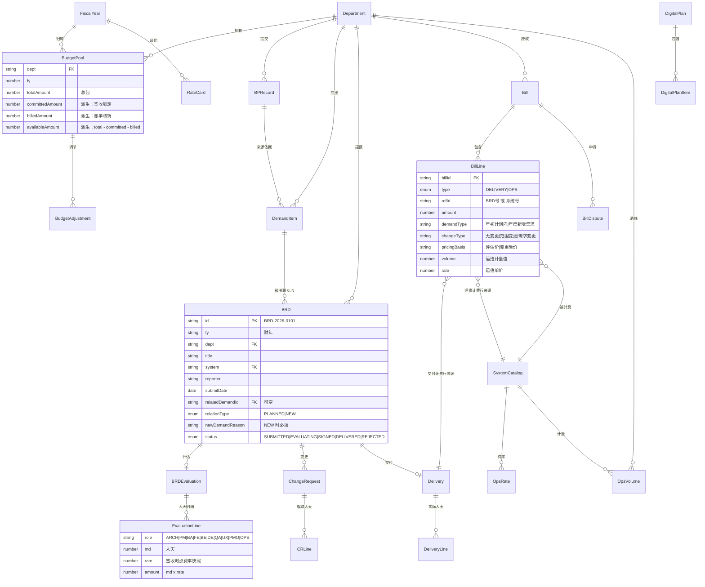
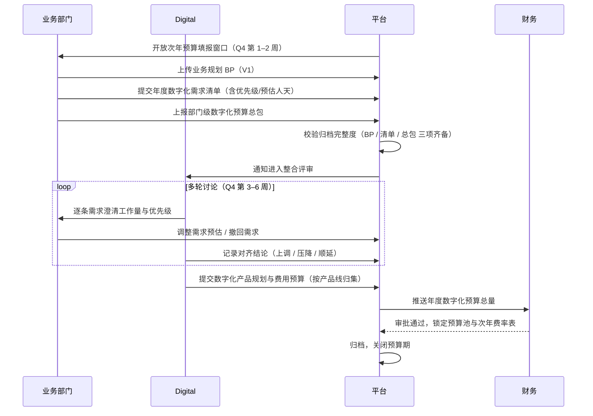
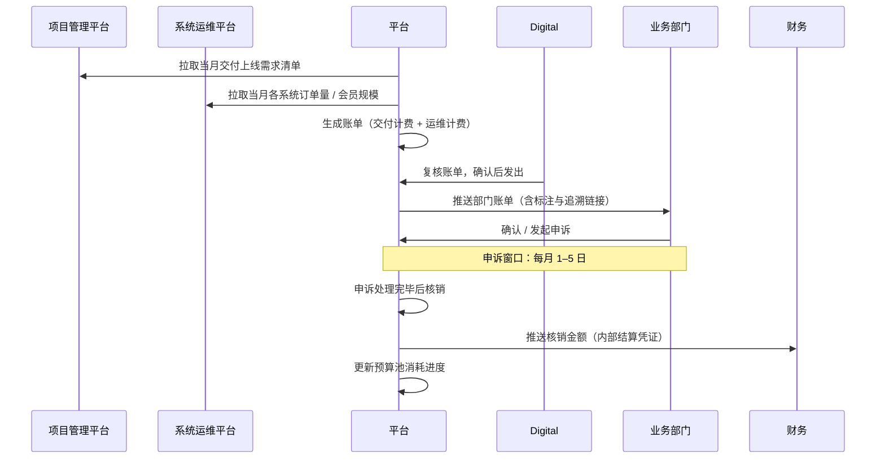

# 迪卡侬中国 · 数字化项目预算管理平台 — 设计方案

| 项目 | 说明 |
|---|---|
| 文档版本 | V1.0 |
| 编制日期 | 2026-09-30 |
| 适用范围 | 迪卡侬中国 Digital 部门 + 各业务部门 |
| 交付形态 | 本设计方案 + 可运行 Demo（React 18 + Ant Design 5，`dist/index.html` 双击即可打开） |
| 关联产出 | `dkt-digital-budget/`（Demo 源码与构建产物） |

---

## 0. 阅读指引

本文档按「**为什么这么设计 → 系统长什么样 → 数据怎么存 → 流程怎么走 → 怎么和现有系统接**」的顺序组织，共 11 章：

- 第 1–2 章是**设计判断**，先看这两章能避免把平台做成一个普通项目管理系统。
- 第 3–7 章是**工程落地内容**，可直接交给研发作为设计输入。
- 第 8–10 章是**治理与实施**，面向决策层。
- 第 11 章说明方案与 Demo 的逐项对应关系。

---

## 1. 需求解码

### 1.1 三阶段的本质

平台要管的是**同一个「钱」在三个时间点的三种形态**：

| 阶段 | 时间 | 钱的形态 | 计量单位 | 管理目标 |
|---|---|---|---|---|
| ① 预算期 | 当年 Q4 | **额度**（计划） | 部门 × 年度 | 把钱分对，且分得有依据 |
| ② 交付期 | 次年滚动 | **承诺**（锁定） | 需求 / BRD | 把钱花在真实需求上，且能溯源 |
| ③ 计费期 | 按月 | **核销**（实际） | 账单行 | 把钱算清，且算得可解释 |

三者的连接点只有一个：**每一张账单行，都必须能回答「它来自哪个需求、哪个 BP」**。

### 1.2 需求 → 系统能力映射

| 原始需求描述 | 系统能力 | 关键设计取舍 |
|---|---|---|
| 各部门产出次年 BP | BP 归档台账，版本化管理 | BP 与需求清单**强绑定**：无 BP 不得提交需求清单 |
| 同步产出需求清单 + 部门预算总包 | 需求清单（DemandItem）+ 预算池（BudgetPool） | 需求清单用「估算口径」，不占用真实额度 |
| Digital 多轮讨论产出整合规划与费用预算 | 数字化规划（DigitalPlan）+ 对齐分析 | 保留**部门上报额**与**Digital 核定额**双列，差异留痕 |
| 三类内容数字化归档 | 归档完整度看板（BP / 需求清单 / 预算总包） | 三项齐备才能进入整合评审，作为流程门禁 |
| 业务提报完整 BRD | BRD 表单 + 附件 + 状态机 | BRD 必填「关联年初需求」，留空则强制填新增原因 |
| 明确是否年度新增需求 | relationType 字段（PLANNED / NEW） | 该标记**贯穿到账单行**，是次年压降的依据 |
| Digital 评估并确认签收 | BRDEvaluation + 签收动作 | 签收即锁定评估价，预算池口径由「已规划」转「已承诺」 |
| 给出交付费用评估并据此结算 | 人天 × 费率表（Rate Card） | 费率**预算期锁定、全年不调价** |
| 按月产出应收账单 | Bill + BillLine | 一个部门一张账单，内含两类计费行 |
| 按交付上线需求收费，标注新增/变更 | BillLine.demandType / changeType / pricingBasis | 三个标注维度是**必填**，不可为空 |
| 按订单量或会员数收运维费 | SystemCatalog + OpsVolume + 费率 | 计费驱动程序必须可测量、可审计 |
| 年度预算池消耗进度 | 三重口径（已规划 / 已承诺 / 已核销） | 只跟踪单一口径必然出错，见 2.2 |

### 1.3 行业对标

本平台在方法论上对应 **ITFM（IT Financial Management）** 与 **TBM（Technology Business Management）** 体系，但需要做三处本地化改造：

| 行业标准能力 | 市面产品（Apptio / ServiceNow） | 本平台的本地化改造 |
|---|---|---|
| 成本池 → 服务 → 消费方分配 | 强（TBM 成本分类法） | **弱化**。本场景不是分摊既有 IT 成本，而是**需求驱动的内部结算** |
| Showback / Chargeback | 强 | 直接上 Chargeback（贵司已有内部结算机制），但保留申诉流程 |
| 服务目录与单位成本 | 强 | 保留，映射为「系统目录 + 计费驱动程序」 |
| 需求 → 交付 → 成本的可追溯 | **弱**（Apptio 强在成本，ServiceNow 强在流程，两者靠集成缝合） | **强化，作为平台核心**。用贯穿式追溯主键替代集成缝合 |
| Run / Change / Grow 分类 | 有 | 简化为**两类账单**：交付计费（Change）+ 运维计费（Run） |

**结论：市面没有开箱即用的产品能完整覆盖本需求。** Apptio 的成本建模能力超出实际需要（本场景不需要跨云成本归集），而它最弱的「需求溯源」恰是本平台最需要的；ServiceNow SPM 有需求流程但缺乏结算能力，且改造成本高于自建。**建议自建，但复用行业的计费模型与治理范式。**

---

## 2. 核心设计判断

以下 5 条是本方案与「一个普通的项目管理 + 报表系统」的分界线。每条都附带取舍说明。

### 2.1 追溯主键是骨架，不是附属功能

**判断：** 平台必须维护一条恒等映射链 —— 预算池里的每一块钱，都能对应到需求、BRD、账单行。

```
BP.ID ──▶ Demand.ID ──┬─▶ BRD.ID ──▶ Evaluation.ID ──▶ Delivery.ID ──▶ BillLine.ID
                      │
                      └─▶ (1 : N，一个年初需求可派生多条 BRD)
```

**取舍：** 这会增加录入负担（提报 BRD 时必须选关联需求）。因此设计了两条缓解措施：

1. 提供「年度新增需求」这一合法出口 —— 允许无关联，但必须填新增原因，且该标记会进入账单与次年压降分析；
2. 提供搜索式选择器（按标题 / 系统 / 优先级过滤），而非要求记住需求编号。

**不做会怎样：** 预算池消耗进度只能靠 Excel 手工对账，月度账单出来后无法回答「这笔钱对应哪个需求」，账单争议无法闭环。

### 2.2 预算池必须分三个口径记账

**判断：** 单一口径必然出错，必须同时维护 Planned / Committed / Billed。

| 口径 | 触发时点 | 含义 | 用途 |
|---|---|---|---|
| **已规划 Planned** | 需求清单定稿 | 混岗均价估算金额 | 影子占用，用于编排与预警，**不锁定额度** |
| **已承诺 Committed** | BRD 签收 | 明细费率评估价 + 已批准变更 | 已占用额度，尚未出账 |
| **已核销 Billed** | 账单确认 | 实际账单金额 | 真实消耗 |

```
可用余额 = 预算总包 − 已承诺 − 已核销
```

**取舍：** Planned 不计入可用余额。原因是需求清单本身就是预估，若计入会导致「清单写得越多、可用额度越少」，业务部门会倾向于少报需求，反而失去规划价值。因此 Planned 仅以虚线形式在进度条上标出位置，用于提示「若全部落地将超包」。

**为什么需要 Committed：** 只跟踪 Billed 会失控 —— 一个已完成签收、正在开发的大项目在上线前对预算池是「隐形」的，等账单出来已经来不及。

### 2.3 费率预算期锁定，全年不调价

**判断：** Rate Card 在预算期一次性确定，全年不变，年度末统一处理差异。

**行业依据：** 月度动态调价在成本上更「精确」，但会让接收方的预算彻底失管。典型反例：某部门 3 月减员 200 人，导致该服务的人均单价上升，其他部门在 4 月因「自己没做任何决策」而超支。这种「技术上正确」的计算会摧毁整个模型的信任。

**取舍：** 年度内会产生累计偏差，需要年末调节窗口消化。本方案接受这一代价 —— **可解释性与可预测性，优先于瞬时精确性**。

### 2.4 弹性透支，而非硬熔断

**判断：** 部门预算池超支时**不阻断**新需求提报，改为显性预警 + 年末调节。

**依据：** 业务部门在当年 Q4 不可能准确预估次年全年需求。硬熔断的直接后果是：Q2 之后业务被卡死，转而绕过 Digital 自行采购（Shadow IT），平台反而失去可见性。

**实现：**

| 消耗率 | 档位 | 系统行为 |
|---|---|---|
| < 70% | 正常 | — |
| 70% – 90% | 关注 | 看板标记 |
| 90% – 100% | 预警 | 看板高亮 + 通知部门负责人 |
| ≥ 100% | 已透支 | 强制要求填写新增原因，并在次年预算编制中自动生成压降建议 |

**年末调节三种路径：** ① 追加额度（需 CFO 审批）；② 计入次年预算压降系数；③ 将部分需求顺延至次年。

### 2.5 变更（CR）独立计价

**判断：** 范围变更与需求变更不并入原评估价，作为独立的变更单（CR）记录，单独审批、单独计价、在账单中单独标注。

**原因：** 业务部门对账单的第一个问题永远是「这笔追加是谁批的、从哪个池子出钱」。如果 CR 被合并进原评估价，这个问题就无法回答。

**账单行上必须落三个标注维度：**

| 维度 | 取值 | 作用 |
|---|---|---|
| 需求类型 | 年初计划内 / 年度新增需求 | 次年预算压降依据 |
| 变更情况 | 无变更 / 范围变更 / 需求变更 | 变更治理依据 |
| 计价依据 | 评估价 / 变更后价 | 争议时的事实基础 |

---

## 3. 核心功能模块

### 3.1 模块总览

```
┌─────────────────────────────────────────────────────────────────────┐
│                    数字化项目预算管理平台                              │
├──────────────┬──────────────┬──────────────┬────────────────────────┤
│  M1 预算期    │  M2 交付期    │  M3 计费期    │  M4 贯穿式能力          │
├──────────────┼──────────────┼──────────────┼────────────────────────┤
│ BP 归档       │ BRD 提报表单  │ 账单生成引擎  │ 追溯主键服务            │
│ 需求清单      │ 需求溯源校验  │ 交付计费       │ 预算池口径计算          │
│ 预算总包      │ 评估签收      │ 运维计费       │ 权限与审批引擎          │
│ 归档完整度    │ 变更（CR）    │ 账单确认/申诉  │ 操作审计日志            │
│ 整合规划      │ 交付登记      │ 消耗进度       │ 主数据（费率/系统目录）  │
│ 对齐分析      │ 偏差分析      │ 趋势分析       │ 通知与预警              │
└──────────────┴──────────────┴──────────────┴────────────────────────┘
```

### 3.2 各模块职责

**M1 预算期**

| 能力 | 说明 |
|---|---|
| BP 归档台账 | 部门 × 年度 × 版本；状态机：未启动 → 编制中 → 已提交 → 已归档 |
| 需求清单管理 | 需求编号自动生成（`DM-{FY}-{序号}`）；字段含优先级、预估人天、实施窗口、是否需提 BRD |
| 预算总包登记 | 部门级年度总包金额 + 上报状态 |
| 归档完整度看板 | 三类内容（BP / 需求清单 / 预算总包）齐备度，作为流程门禁 |
| Digital 整合规划 | 按产品线归集的费用预算 + 项目数 + 覆盖部门 |
| 对齐分析 | 部门上报额 vs Digital 核定额，记录调整幅度与整合结论 |
| 额度调节 | 支持年度内追加 / 压降，留痕并记入审计 |

**M2 交付期**

| 能力 | 说明 |
|---|---|
| BRD 提报 | 必填项：标题、部门、提报人、承接系统、业务价值、期望上线、**关联年初需求** |
| 年度新增判定 | 未关联年初需求时，表单动态出现「新增原因」必填项，并自动标记 relationType=NEW |
| 评估签收 | 按角色 + 人天的明细录入，实时按费率表计算金额；签收后状态锁定 |
| 变更管理 | CR 类型（范围变更 / 新增范围 / 需求调整 / 工期顺延）+ 增减人天，独立审批 |
| 交付登记 | 记录实际上线日期与实际投入人天 |
| 偏差分析 | 评估人天 vs 实际人天、清单预估 vs 最终结算，反哺次年估算精度 |
| 追溯查询 | BRD 详情内嵌 Steps 组件展示完整链条 |

**M3 计费期**

| 能力 | 说明 |
|---|---|
| 账单生成 | 按月 × 部门生成，自动汇聚当月上线交付 + 当月运维量 |
| 交付计费 | 逐条需求计价，强制打上需求类型 / 变更情况 / 计价依据三个标注 |
| 运维计费 | 逐系统计价，支持按订单量、按会员规模、固定年费三种模式 |
| 账单流转 | 待出账 → 已发出 → 已确认核销；支持部门申诉 |
| 消耗进度 | 三重口径进度条 + 月度趋势 + 各系统运维明细下钻 |
| 双视角 | 按部门视角（谁欠多少钱）与按系统视角（哪个系统收了多少运维费） |

**M4 贯穿式能力**

| 能力 | 说明 |
|---|---|
| 追溯主键服务 | 提供 `traceByDemand` / `traceByBrd` 两个查询入口，返回完整链路 |
| 预算池口径计算 | 所有金额的唯一真相来源，禁止各页面自行计算 |
| 审批引擎 | 可配置的审批矩阵（评估签收 / CR 审批 / 额度调节 / 账单核销） |
| 审计日志 | 记录操作人、动作、对象、时间 |
| 主数据管理 | 费率表、系统目录、运维费率、部门与预算池 |

---

## 4. 数据模型

### 4.1 实体清单（25 个）

| 域 | 实体 |
|---|---|
| 组织 | `Department` `User` `Role` `Permission` `UserRole` |
| 财务主数据 | `FiscalYear` `RateCard` `SystemCatalog` `OpsRate` |
| 预算期 | `BPRecord` `DemandItem` `BudgetPool` `BudgetAdjustment` `DigitalPlan` `DigitalPlanItem` |
| 交付期 | `BRD` `BRDEvaluation` `EvaluationLine` `ChangeRequest` `CRLine` `Delivery` `DeliveryLine` |
| 计费期 | `OpsVolume` `Bill` `BillLine` `BillDispute` |
| 审计 | `AuditLog` |

### 4.2 ER 图



### 4.3 关键字段设计说明

**`BRD.relationType` 与 `BRD.newDemandReason`**

```sql
-- 约束：无关联年初需求时，必须说明新增原因
CHECK (
  (related_demand_id IS NOT NULL AND relation_type = 'PLANNED' AND new_demand_reason IS NULL)
  OR
  (related_demand_id IS NULL AND relation_type = 'NEW' AND new_demand_reason IS NOT NULL)
)
```

**`EvaluationLine.rate` 必须做快照**

评估人天明细行必须记录**签收时点的费率值**，不能只存 role 后关联费率表。原因：费率表按年度版本化存储（`RateCard.fy`），若只存 role，历史评估价会随费率表更新而漂移，导致已签收的合同金额发生变化 —— 这是审计红线。

**`BillLine` 的三个标注字段为 NOT NULL**

```
demand_type    NOT NULL   -- 年初计划内 / 年度新增需求
change_type    NOT NULL   -- 无变更 / 范围变更 / 需求变更
pricing_basis  NOT NULL   -- 评估价 / 变更后价
```

运维计费行这三个字段填 `N/A`，但不可为 NULL —— 强制研发在写入时显式决策，避免遗漏。

**派生字段 vs 存储字段**

| 字段 | 策略 | 理由 |
|---|---|---|
| `BudgetPool.committedAmount` | **派生计算**，不落库（或落库但标注为缓存） | 由 BRD 签收状态聚合而来，落库会产生不一致 |
| `BudgetPool.billedAmount` | **派生计算** | 由已确认账单聚合 |
| `Bill.totalAmount` | 落库（生成时固化） | 账单是财务凭证，一旦生成不可回溯变化 |
| `EvaluationLine.rate` | 落库（快照） | 见上 |

**Demo 中的对应实现：** `src/domain/calc.js` 中 `poolState()` 即为派生计算的唯一入口，`buildBill()` 为账单固化入口。这两个函数在真实实施时应原样下沉到服务端。

### 4.4 追溯主键设计

| 实体 | 主键格式 | 生成规则 |
|---|---|---|
| BP | `BP-{FY}-{部门简码}` | 每部门每财年一条 |
| 需求 | `DM-{FY}-{4位序号}` | 财年内全局自增 |
| BRD | `BRD-{FY}-{4位序号}` | 财年内全局自增 |
| 变更 | `CR-{FY}-{4位序号}` | 财年内全局自增 |
| 账单 | `BILL-{YYYYMM}-{部门简码}` | 月份 + 部门唯一 |
| 账单行 | `{账单号}-{序号}` | — |

**一个年初需求可派生多条 BRD**（例如拆成两期交付），因此 `DemandItem : BRD = 1 : N`。追溯查询时必须聚合展示，不能假设一对一。

---

## 5. 关键流程

### 5.1 预算期流程（当年 Q4）



**流程门禁：** 三项归档物不齐备的部门，不进入 Digital 整合评审环节。

**平台化的价值点：** 需求清单的每一次调整都留痕（谁改的、改前改后），年末复盘时可直接回答「为什么某需求被砍」。

### 5.2 交付期流程（次年滚动）

```
业务提报 BRD
   │
   ├─ 是否关联年初需求？
   │     ├─ 是 → relationType = PLANNED，记录 relatedDemandId
   │     └─ 否 → relationType = NEW，强制填写新增原因
   │
   ▼
Digital 受理 → 状态 SUBMITTED
   │
   ▼
Digital 评估中 → 状态 EVALUATING
   │  （澄清需求、确认工作量）
   ▼
出具交付费用评估（人天 × 费率表）
   │
   ├─ 双方确认 → 签收 → 状态 SIGNED
   │     └─ 预算池：金额从「已规划」转入「已承诺」
   │
   └─ 驳回 → 状态 REJECTED（需填写驳回原因）
   │
   ▼
执行交付（期间可发起 CR 变更单）
   │
   ▼
登记交付上线 → 状态 DELIVERED
   │
   ▼
进入上线月份的账单
```

### 5.3 计费期流程（月度）



### 5.4 变更（CR）流程

```
提出变更（业务方或 Digital 均可）
   │
   ▼
变更评估（增减人天 × 费率表）
   │
   ▼
审批（按金额分级：< 50 万 Digital 负责人 / ≥ 50 万 + 业务负责人 / ≥ 200 万 + CFO）
   │
   ├─ 驳回 → 流程结束
   └─ 批准 → 记入 BRD.crs
              │
              ├─ 预算池「已承诺」金额同步增加
              └─ 账单行标注 changeType = 范围变更 / 需求变更，pricingBasis = 变更后价
```

### 5.5 预算池状态机

```
         ┌──────────────────────────────────────────┐
         │            部门预算池（FY）                │
         └──────────────────────────────────────────┘
                            │
        ┌───────────────────┼───────────────────┐
        ▼                   ▼                   ▼
   【已规划】            【已承诺】           【已核销】
   需求清单预估          BRD 签收锁定          账单确认
   影子占用              占用额度              真实消耗
   不锁额度              不出账                可申诉
        │                   │                   │
        │  签收时转化 ───────▶│                   │
        │                   │  出账核销 ────────▶│
        │                   │                   │
        └───────────────────┴───────────────────┘
                            │
                            ▼
              可用余额 = 总包 − 已承诺 − 已核销
                            │
              ┌─────────────┴─────────────┐
              ▼                           ▼
           ≥ 0                         < 0
        正常/关注/预警                已透支
                                    → 年末调节窗口
```

---

## 6. 计费引擎规则

### 6.1 账单 A · 交付计费

**计价公式：**

```
交付计费行金额 = Σ(角色人天 × 该角色费率) + Σ(已批准 CR 增减金额)
```

**出账时点：** 以 BRD 的**实际上线月份**为准。当月的账单中生成一条 `type = DELIVERY` 的账单行。

**必须携带的标注：**

| 字段 | 取值来源 |
|---|---|
| `demandType` | `BRD.relationType` → 年初计划内 / 年度新增需求 |
| `changeType` | `BRD.crs` 数量与类型 → 无变更 / 范围变更 ×N / 需求变更 ×N |
| `pricingBasis` | 有已批准 CR 则为「变更后价」，否则为「评估价」 |

### 6.2 账单 B · 运维计费

**三种计费模式：**

| 模式 | 公式 | 适用系统 | 费率示例 |
|---|---|---|---|
| 按订单量 `order` | 订单量 × 单价 | 官网、App、POS、OMS | ¥0.62 / 单 |
| 按会员规模 `member` | 规模（千人）× 单价 | 会员 CRM、数仓 BI | ¥42 / 千人/月 |
| 固定年费 `fixed` | 年费 ÷ 12 × 部门份额 | 供应链协同、客服工单 | ¥240 万 / 年 |

**计量粒度：** 系统 × 部门 × 月。同一系统被多部门使用（如数仓 BI 被全部 8 个部门使用）时，按各部门实际消耗分别计费，不做平均分摊。

**计量值来源：** 系统运维平台按月采集，通过适配层写入 `OpsVolume`。

**争议处理的关键：** 账单行必须能关联到源系统的用量明细查询入口。本方案在 `BillLine` 上保留 `refId`（系统号）+ `volume`（计量值）+ `rate`（单价）三元组，任意一笔金额都可反算复核。

### 6.3 结算与偏差分析

| 指标 | 公式 | 用途 |
|---|---|---|
| 估算偏差（清单级） | 最终结算价 ÷ 清单预估金额 − 1 | 反哺次年需求清单的估算精度 |
| 人天偏差（BRD 级） | 实际投入人天 ÷ 评估人天 − 1 | 评估能力度量 |
| 变更率 | Σ CR 金额 ÷ Σ 评估价 | 需求稳定性度量 |
| 新增需求占比 | 年度新增需求金额 ÷ 预算池总额 | 次年预算压降的直接输入 |

**设计要点：** 估算阶段使用混岗均价（¥2,850/人天）快速估算，签收阶段切换为明细费率。因此 10% 量级的偏差属正常范围，平台在界面上明确说明这一点，避免使用者误判。

---

## 7. 系统边界与集成

### 7.1 集成总览

```
        ┌──────────────────────────────────┐
        │   数字化项目预算管理平台（自建）    │
        └──────────────────────────────────┘
             ▲            ▲            ▲
   适配层 A  │   适配层 B  │   适配层 C │
             │            │            │
   ┌─────────┴──┐  ┌──────┴─────┐  ┌──┴────────┐
   │ 项目管理平台 │  │ 系统运维平台 │  │  财务系统  │
   │ （需求/工时/ │  │（订单量/会员 │  │（成本中心/ │
   │  交付状态）  │  │  规模/可用性）│  │  内部结算） │
   └────────────┘  └────────────┘  └───────────┘
```

### 7.2 适配层接口清单

**适配层 A · 项目管理平台**

| 方向 | 接口 | 频率 | 说明 |
|---|---|---|---|
| 拉取 | `GET /projects/delivered?month=YYYY-MM` | 每日 | 当月交付上线的需求清单 |
| 拉取 | `GET /projects/{id}/efforts` | 按需 | 实际投入人天明细 |
| 推送 | `POST /demands` | 按需 | 预算期需求清单同步（可选） |

**适配层 B · 系统运维平台**

| 方向 | 接口 | 频率 | 说明 |
|---|---|---|---|
| 拉取 | `GET /metrics/orders?system=&dept=&month=` | 每日 | 订单量 |
| 拉取 | `GET /metrics/members?system=&dept=&month=` | 每日 | 会员规模 |
| 拉取 | `GET /systems` | 每周 | 系统目录与状态 |

**适配层 C · 财务系统**

| 方向 | 接口 | 频率 | 说明 |
|---|---|---|---|
| 推送 | `POST /settlements` | 每月核销后 | 内部结算凭证 |
| 推送 | `POST /budgets/annual` | 年度一次 | 年度预算总量 |
| 拉取 | `GET /cost-centers` | 每周 | 成本中心主数据 |

### 7.3 适配层设计要求

1. **幂等**：所有拉取接口按 `(对象ID, 月份)` 幂等，重复拉取不产生重复计费。
2. **可降级**：外部系统不可用时，支持手工 Excel/CSV 导入兜底，并标记数据来源。
3. **留痕**：每次同步记录批次号、拉取时间、记录数、校验和。
4. **数据来源标记**：`OpsVolume.source ∈ {api, manual}`，账单上可区分。

**本期实施策略（与决策一致）：** 先建独立平台与标准数据模型，用导入数据跑通全流程；适配层先产出接口契约与 Mock 服务，待权责确认后接入。

---

## 8. 权限与治理

### 8.1 角色矩阵

| 角色 | 预算期 | 交付期 | 计费期 | 主数据 |
|---|---|---|---|---|
| 业务部门提报人 | 提交需求清单 | 提报 BRD | 查看本部门账单 | — |
| 业务部门负责人 | 确认 BP 与总包 | 确认 CR | 确认 / 申诉账单 | — |
| Digital 交付经理 | 参与整合评审 | 评估签收 / 审批 CR | 复核账单 | — |
| Digital 负责人 | 提交整合规划 | 审批大额 CR | 确认核销 | 费率表审批 |
| 财务 | 审批年度预算总量 | — | 接收结算凭证 | 费率表联合审批 |
| 平台管理员 | — | — | — | 系统目录 / 权限 |

### 8.2 审批矩阵

| 事项 | < 50 万 | 50 – 200 万 | ≥ 200 万 |
|---|---|---|---|
| BRD 评估签收 | Digital 交付经理 | + 业务负责人 | + Digital 负责人 |
| 变更（CR） | Digital 交付经理 | + 业务负责人 | + CFO |
| 预算额度追加 | 部门负责人 | + Digital 负责人 | + CFO |
| 账单核销 | 业务负责人 | + Digital 交付经理 | — |

---

## 9. 非功能性要点

### 9.1 数据一致性

- **金额唯一真相来源**：所有金额计算集中在领域服务层，前端只做展示。Demo 中体现为 `src/domain/calc.js` 为纯函数、无 UI 依赖。
- **账单不可回溯变更**：账单一旦生成，金额固化；调整必须通过「调整单」而非修改原账单。
- **费率快照**：评估明细行必须冗余存储费率值。

### 9.2 对账与审计

| 对账项 | 频率 | 规则 |
|---|---|---|
| 预算池总量 = 各口径之和 | 每日 | `total = available + committed + billed` |
| 账单总额 = 各账单行之和 | 生成时 | 强校验，不通过不允许发出 |
| 运维计量值 vs 源系统 | 每月 | 差异 > 0.5% 告警 |
| 追溯完整率 | 每月 | 无溯源 BRD 占比（即年度新增需求比例） |

### 9.3 量级估算

| 维度 | 量级 | 说明 |
|---|---|---|
| 部门数 | ~10 | 变化小 |
| 需求清单 | ~200 / 年 | — |
| BRD | ~300 / 年 | — |
| 账单行 | ~10 部门 × 12 月 × (3 交付 + 8 运维) ≈ 1,300 / 年 | 可忽略 |
| 数据总量 | 五年 < 5 万行 | **完全不需要大数据架构** |

**结论：** 这是一个**逻辑复杂但数据量极小**的系统。架构上应优先保证模型正确性与可审计性，不需要分库分表、不需要分布式。技术选型建议：单体应用 + 关系型数据库 + 定时任务，即可支撑。

---

## 10. 分期实施建议

| 阶段 | 周期 | 交付范围 | 验收标准 |
|---|---|---|---|
| **P0 骨架** | 4 周 | 主数据（部门/系统/费率表）+ 数据模型 + 追溯主键服务 | 可录入一套完整数据并跑通追溯查询 |
| **P1 预算期** | 4 周 | M1 全部能力 | 完成一次模拟的次年预算编制，产出三类归档物 |
| **P2 交付期** | 6 周 | M2 全部能力（含 CR） | 完成 10 条 BRD 的提报 → 签收 → 交付全流程 |
| **P3 计费期** | 6 周 | M3 全部能力（先手工导入数据） | 产出 3 个月账单并与手工台账核对一致 |
| **P4 集成** | 4 周 | 三条适配层 | 数据自动同步，人工干预率为 0 |

**关键建议：** P0/P1 阶段不要等外部系统接口。先用 Excel 导入跑通业务闭环，让业务部门认可口径，再谈集成。**口径不认可的情况下做集成，等于把错误的口径自动化。**

---

## 11. 方案与 Demo 的对应关系

| 设计方案章节 | Demo 中的实现位置 |
|---|---|
| 2.1 追溯主键 | `src/domain/calc.js` → `traceOfDemand()` / `traceOfBrd()`；页面 `#/trace` |
| 2.2 三重口径 | `src/domain/calc.js` → `poolState()`；组件 `PoolMeter` |
| 2.3 费率锁定 | `src/data/mock.js` → `RATE_CARDS`（按财年版本化）；`EvaluationLine.rate` 快照逻辑体现在 `rateOf()` |
| 2.4 弹性透支 | `src/domain/calc.js` → `poolLevel()` 四档判定；页面 `#/home` 关注提示 |
| 2.5 变更独立计价 | `src/domain/calc.js` → `brdCRDelta()`；账单行 `changeType` / `pricingBasis` |
| 3.2 M1 预算期 | 页面 `#/budget`（5 个 Tab：预算总包 / 归档完整度 / BP / 需求清单 / 整合规划） |
| 3.2 M2 交付期 | 页面 `#/delivery`（提报 / 评估签收 / CR / 登记上线 / 详情抽屉） |
| 3.2 M3 计费期 | 页面 `#/billing`（月度账单 / 双视角 / 账单详情 / 核销） |
| 4.2 数据模型 | `src/data/mock.js` 的数据结构与字段命名与本文档一致 |
| 5.2 交付期流程 | 提报表单中「未关联年初需求 → 动态出现新增原因必填」的交互 |
| 5.5 预算池状态机 | `poolState()` 返回的 `committed` / `billed` / `available` / `level` |
| 6.1 交付计费 | `buildBill()` 中 `type = 'DELIVERY'` 的分支 |
| 6.2 运维计费 | `opsLineAmount()` 三种模式分支 |
| 6.3 偏差分析 | `#/trace` 的「估算偏差」列；BRD 详情中的「人天偏差」 |
| 7 系统边界 | Demo 使用 `mock.js` 替代适配层，接口契约见 7.2 |
| 8 权限治理 | Demo 未实现（原型以单角色演示为主），设计见第 8 章 |

---

## 附录 A · 待确认事项

以下问题建议在 P0 启动前与业务方确认，会影响数据模型：

1. **跨年度项目的归属规则**：一个项目跨越财年时，是全额计入启动年，还是按交付节点拆分到各年？
2. **运维费率的调整机制**：费率预算期锁定后，若年中系统架构发生重大变化（如从自建迁移至云），是否有例外通道？
3. **部门份额的分摊规则**：像数仓 BI 这类被全部部门共用的平台系统，除按实际用量外，是否需保留一部分「公共成本」由中心承担？行业实践建议保留 15–25% 的中心承担比例，避免「用得多就被罚」的逆向激励。
4. **账单申诉的时效与终局机制**：申诉超期未处理如何处理？是否有最终裁决人？
5. **与实际财务系统的结算口径**：账单确认后是否触发真实的成本中心划转，还是仅做管理口径的 Showback？
