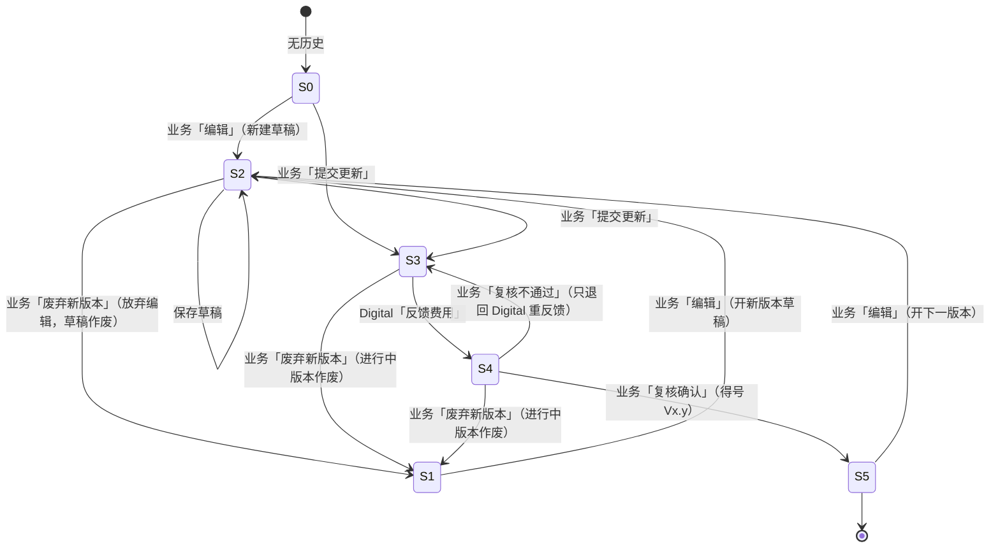

# v0.8 《项目预算计划》独立页面 · 需求描述与设计说明

> 本文件是**需求描述文档（Design Brief）**，不是实现文档。目的：把用户口述的 4 点需求形式化，逐条判定「理解准确 / 需修正 / 需澄清」，收敛歧义，输出可直接交给研发的需求基线。
> 本轮**只产出文档，不改任何源码**。文中所有"现状"均以当前代码为准（行号取自 `src/pages/BudgetModule.jsx`、`src/store.jsx`、`src/domain/calc.js`、`src/App.jsx`），与代码不符处以代码为准。

---

## 修订记录

> 用户三轮拍板结果（2026-09-30）。第一轮 4 条 + 第二轮 3 条 + 第三轮 3 条，逐条注明采纳状态。

**第一轮（2026-09-30）**

| # | 议题 | 用户拍板结果 | 是否采纳本分析师推荐 |
|---|---|---|---|
| ① | 页面作用域 | = 「一个部门 × 一个编制年」（部门级） | **采纳推荐** |
| ② | 业务复核不通过的去向 | **只退 Digital 重新反馈费用**（业务不可修改清单内容）；补齐「废弃新版本」出口 | **未采纳推荐**（推荐为双出口） |
| ③ | 「项目预算管理表页面」的指代 | = **《项目预算计划》页自身的项目列表**；《年度预算计划》主表列本轮范围外 | **未采纳推荐**（推荐为《年度预算计划》主表） |
| ④ | 「业务价值预估」口径 | = **「业务价值：生意增量贡献」**（非费用预估，量纲待定） | **未采纳推荐**（推荐口径 A = 复用 `estAmount` 已被排除） |

**第二轮（2026-09-30）**

| # | 议题 | 用户拍板结果 | 是否采纳本分析师推荐 |
|---|---|---|---|
| ⑤ | 「业务价值预估」量纲 | = **自由文本（string）**，新增 `demands.bizValue` | **未采纳推荐**（推荐为金额口径，用户选自由文本） |
| ⑥ | 列表是否保留 `estAmount` 为独立列 | **保留为独立列**（当时为 8 列：7 业务列 + 操作；第三轮 ⑩ 移除「项目描述」后为 **7 列**） | **采纳推荐** |
| ⑦ | 进行中版本入口形态 | = **独立二级路由** `#/budget/project/{deptCode}/new` | **未采纳推荐**（相较 `?ver=new` 多一处路由解析改动，见 §8-#18） |

**第三轮（2026-09-30）**

| # | 议题 | 用户拍板结果 | 是否采纳本分析师推荐 |
|---|---|---|---|
| ⑩ | 列宽定稿 | = **方案 B**（「项目描述」收进详情，列表 8 列 → **7 列**，`scroll.x=1000`） | **采纳推荐**；⚠️ **偏离原始需求**：原第 2 点要求「项目描述」在列表内，现改由详情承载，系**用户知情后取舍**（§4.5） |
| ⑪ | Q10 编辑态「业务预估（万元）」可改性 | = **方案 (a)**：编辑态直接改 `estAmount` | **推导落地（非用户单选形态）**：⑫ 删除 `estMD` ⇒ 「内嵌人天输入」形态不可行 ⇒ 落到 (a)（§7-Q10） |
| ⑫ | `estMD` 与 `demand.system` | **两条均连数据字段一并删除**；`estAmount` 改为人工录入 | **未采纳推荐**（推荐 A：移入详情保留）；连带影响见 §8.1 |

---

## 结论前置（3 条最关键的修正）

1. **页面作用域 = 「一个部门 × 一个编制年度」（用户已拍板确认）**。点击对象是「《年度预算计划》主表中某业务部门的『② 项目预算』单元格」——主表每行 = 一个业务部门（`calc.annualPlanRow`），第 ② 列才是项目预算。因此《项目预算计划》页面的标题应为「{部门名} · 项目预算计划」，列表 = 该部门下的**全部项目**。**用户口径中的「项目」= 该部门该编制项下的单条项目，聚合根仍是 `demand`，编号沿用 `DM-` 不变。**
2. **用户描述的新流程（编辑 → 提交 → Digital 反馈费用 → 业务复核确认）与已定稿的 v0.5 状态机冲突**：v0.5 里 Digital「完成评估」**即刻得号并置为"已确认"**（`store.jsx` 156–175 行），没有"业务复核确认"这一环，也没有"草稿"态。本轮需**新增草稿态 + 业务复核确认门禁**，并把**得号触发点从"Digital 完成评估"后移到"业务复核确认"**——这是对既有实现的行为变更，牵动 `store.jsx` / `calc.js`。
3. **两项术语已由用户拍板**：「项目预算管理表页面」指 **《项目预算计划》页自身的项目列表**（代码库中本无此名词，全库检索确认）；「业务价值预估」口径 = **「业务价值：生意增量贡献」**，**不是费用预估**，与 `estAmount` 不是同一个东西，量纲待第二轮确认（§4.4 / §7-Q9）。

---

## 一、需求理解确认

逐条复述用户原文，并给出判定。

### 第 1 点：独立页面 + 概览楼层 + 合并模块

> 原文：《项目预算计划》页面主体内容为项目需求列表。页面顶部保留概览楼层，内容更新为当前版本与项目总费用；将页面中的版本记录与操作留痕合并为统一模块。

**判定：作用域已确认；概览卡取舍需修正 1 处；合并模块理解准确。**

| # | 用户表述 | 判定 | 修正与理由 |
|---|---|---|---|
| 1.1 | 主体内容为"项目需求列表" | **已确认** | "项目"与"需求"是**同一实体的两个叫法**（见 §9 名词表）。用户口径中的**「项目」= 该部门该编制项下的单条项目，聚合根仍是 `demand`，编号沿用 `DM-` 不变**（改号段会波及全局搜索、BRD 关联、账单溯源）。前端文案统一用「项目」。 |
| 1.2 | 概览"内容更新为当前版本与项目总费用" | 需修正 | 方向正确，但"项目总费用"必须给口径。现有 4 张卡中「当前版本状态」「生效版本号」应**合并为一卡「当前版本」**；「清单费用合计」正是"项目总费用"，**改名保留**；「版本数量」**降级删除**（信息迁到统一模块标题行）。详见 §3.2。 |
| 1.3 | 版本记录与操作留痕"合并为统一模块" | 理解准确 | 两表现在确实重复（同一次"提交/完成评估"既写 `demandVersions` 又写 `planActivities`），并列展示是冗余。合并为**一条时间线/流水**，每条 = 时间 · 版本号 · 状态 · 动作 · 操作人（角色）· 变更说明。详见 §3.4。 |

### 第 2 点：列表字段 6 项

> 原文：列表字段包含：项目编号、项目名称、项目描述、优先级、业务价值预估、Digital预算费用。

**判定：2 处需新增字段、1 处口径已拍板。**

| 用户字段 | 现有模型映射 | 判定 |
|---|---|---|
| 项目编号 | `demands.id`（`DM-{FY}-{4位}`） | 准确，仅改 UI 文案（"需求编号"→"项目编号"），号段不变 |
| 项目名称 | `demands.title` | 准确（"需求标题"→"项目名称"） |
| 项目描述 | **不存在** | 需新增字段 `desc`，建议长文本、可空（见 §4） |
| 优先级 | `demands.priority`（P0/P1/P2） | 准确 |
| 业务价值预估 | **不存在** | 用户已拍板 = 「业务价值：生意增量贡献」，**非费用预估**；与 `estAmount` 不是同一个东西，量纲待定（见 §4.4） |
| Digital预算费用 | `demands.evalAmount`（元，万元展示） | 准确（原"项目预算费用"→"Digital预算费用"，仅改文案） |

- **未出现在清单里的现有列**「承接系统 `system`」「预估人天 `estMD`」「业务预估（万元）`estAmount`」：**第三轮已拍板**——`承接系统` 与 `预估人天` **连数据字段一并删除**；`estAmount` **保留为独立列**并改为**人工录入**；「项目描述」改由「详情」承载（§4.2 / §4.5 / §8.1）。
- **口径已拍板（排除费用口径）**：「业务价值预估」= 「业务价值：生意增量贡献」，**不是**现有「业务预估（万元）`estAmount`」；量纲待第二轮确认，见 §4.4 / §7-Q9。

### 第 3 点：默认只读 + 编辑按钮 + 新版本流程

> 原文：列表默认只读，并提供编辑按钮。点击编辑后，列表进入新版本编辑页面，开启新版本流程，即，支持业务编辑或保存当前编辑内容；编辑完成后提交更新，随后由Digital反馈费用，业务复核确认，这些流程。

**判定：需修正 3 处、澄清 1 处。**

| # | 冲突/缺口 | 说明 | 处理方向 |
|---|---|---|---|
| 3.1 | 与 v0.5 编辑权限冲突 | 现状：在「待评估费用」阶段，**Digital 直接在清单表内逐条改 `evalAmount`**（`BudgetModule.jsx` 981–991 行 `editable`）。新需求要求"列表默认只读 + 编辑按钮"，意味着编辑态需**按角色拆成两段**：业务编辑"项目内容"，Digital 编辑"Digital预算费用"。 | 引入"编辑中（草稿）"与"待 Digital 反馈"两个独立态，编辑入口与可编辑列分离（§5） |
| 3.2 | 与 v0.5 状态机冲突 | 现状：**Digital「完成评估」即得号并置"已确认"**（`store.jsx` 156–175 行），**没有"业务复核确认"**。 | 新增"待业务复核确认"态；**得号触发点后移到业务复核确认**（§5） |
| 3.3 | 缺"草稿"态 | 原文"支持业务编辑或保存当前编辑内容"= 需要草稿持久化，v0.5 无此态。 | 新增草稿态（保存/放弃），存储方案见 §7-Q4 |
| 3.4 | 编辑粒度需澄清 | 是"整份清单替换式编辑"还是"允许逐条增删改并各自成版本"？ | 建议**沿用 v0.5「整份清单为一个版本」**，逐条只是编辑手段，不逐条管理版本（见 §7-Q8） |

### 第 4 点：进行中版本不进管理表，仅在原列表放入口

> 原文：新版本在最终业务确认前，不直接展示在项目预算管理表页面，仅在原列表上放置入口，提示存在进行中的新版本项目预算；点击该入口可进入新版本项目预算页面，进行编辑或查看。

**判定：理解准确；指代已拍板（= 本页列表）；主表相关修正本轮范围外。**

- **消歧（用户已拍板）**：「项目预算管理表页面」**在代码库中不存在**（全库检索：无此路由、无此组件、无此 `data-testid`；仅有平台品牌名"数字化项目预算管理平台"）。**经用户确认，它指的是《项目预算计划》页自身的项目列表**（不是《年度预算计划》主表）。全文据此统一改称「《项目预算计划》页的项目列表」。
- **附带说明（本轮范围外）**：`calc.demandConfirmedAmount` 的口径修正、《年度预算计划》主表「② 项目预算」格的进行中徽标，**因用户已把"管理表"定义为本页列表，本轮不在范围内**。"列表恒展示正式版本内容、进行中版本另立入口"的语义改由 §6 承载。

---

## 二、页面定位与入口变更

### 2.1 从浮层到独立页面

现状：点击主表「② 项目预算」格 → `setCtx({stage:'DEMAND', dept})` → 打开 **右侧 Drawer 浮层**（`BudgetModule.jsx` 636–688 行），浮层内渲染 `DemandPanel`（860–1083 行）。

目标：该下钻改为**独立页面**，获得 URL、可刷新、可分享、可后退。

| 项 | 方案 |
|---|---|
| 路由 key | 新增 `project`，基础路径 **`#/budget/project/{deptCode}`**（= 正式版本**只读**视图）；新版本路径 **`#/budget/project/{deptCode}/new`**（= 进行中版本视图，编辑 / 查看） |
| 路由段位 | 基础路由 = 现有三段 `seg/sub/param`；`/new` 是**第四段**，而现有 `useHashRoute` 只解析三段、会**静默丢弃**第四段 → 必须扩展解析（见 §8-#18），否则 `/new` 退化成基础视图 |
| 为什么不是复用 annual | `annual` 的 `param` 已被"部门代码 / `DM-` 单号"占用为**抽屉**语境（`AnnualPlanView` 319–327 行深链逻辑），复用会与现有 SUMMARY/DEMAND 抽屉抢路由 |
| 为什么 key 不能叫 `demand`/`plan`/`bp`/`pool`/`deptpool` | 这些是 `App.jsx` `LEGACY_VIEWS.budget` 的旧视图名，会被旧链接重定向逻辑拦截，造成"新页被抢成 annual" |
| 需改动 | `App.jsx` `MODULE_VIEWS.budget` 增一项 `{key:'project', label:'项目预算计划'}`；`MODULE_DEFAULT_VIEW` 不变 |
| SiderNav | **不改**。`SiderNav` 使用自己硬编码的 `GROUPS`（`SiderNav.jsx` 15–49 行），与 `MODULE_VIEWS` 解耦，新增 view 不会出现在左导航——这正是下钻页应有的表现（不占一级导航） |
| 面包屑 | 复用 `App.jsx` 内容区定位条（288–311 行）：`#/budget/project/D-RETAIL` → 「预算管理 · 编制与消耗 › 项目预算计划 › D-RETAIL」；`/new` 时第四段需一并纳入末段展示（如「… › D-RETAIL › 新版本」），依赖 §8-#18 的解析扩展 |

### 2.2 进入 / 退出路径

| 方向 | 路径 |
|---|---|
| 进入①主入口 | 《年度预算计划》主表 → 部门行「② 项目预算」格 → `#/budget/project/{deptCode}`（正式版本只读视图） |
| 进入②进行中入口 | 基础视图列表上方的**进行中入口徽标**（见 §6.2）→ **`#/budget/project/{deptCode}/new`**（进行中版本视图，编辑 / 查看） |
| 进入③全局搜索 | 顶栏输入 `DM-2027-0001` → `#/budget/project/D-RETAIL?focus=DM-2027-0001`（聚焦该行并高亮） |
| 退出 | 基础视图页头「返回年度预算计划」按钮 → `#/budget/annual`；`/new` 页头「返回」→ 基础路由；浏览器后退同样有效 |

### 2.3 深链可分享性

`#/budget/project/D-RETAIL` 与 `#/budget/project/D-RETAIL/new` 均可分享、可刷新。两处都依赖对 `useHashRoute` 的扩展：① `/new` 是**第四段**，现有解析器只读 `seg/sub/param` 并**丢弃第四段**（`App.jsx` 83–89 行），不扩展则 `/new` 会静默退化为基础视图；② "聚焦某条项目"需查询参数，而现有解析器**丢弃 `?` 之后的内容**。若采纳 §2.2 的 `?focus=`，也需解析 query。两处改动位置见 §8-#18。若不扩展 `?focus=`，全局搜索 `DM-` 落到页面后需用户在列表内自行查找（可接受但体验降级）。

### 2.4 从「预算消耗」视图能否进入

**建议本轮不加入口。** 理由：两个视图的**年度语境不同**——《年度预算计划》固定为编制年 `PLAN_FY = 2027`（`BudgetModule.jsx` 70 行），而《预算消耗》跟随全局年度 `globalFy`（可切 2026 执行年 / 2027 编制年）。在消费视图加入口会引入"点进去看到的是另一年份的预算"的认知错位。若业务坚持要，仅当 `globalFy === 2027` 时显示入口，且以只读方式进入。

### 2.5 其他编制项是否也页面化

**本轮仅"② 项目预算"页面化**，`BP`（① 年度 BP）与 `OPS`（③ 系统运维预算）**保持现有 Drawer**，以控制改动面。代价：同一主表三种下钻两种形态（页面 / 浮层）。建议在 §7 提出后续统一项，交由业务决定，不在本轮做。

---

## 三、页面结构规范

页面自上而下 5 个楼层。命名与现有组件对齐（`PageHead` / `Metric` / `Alert` / `Table` / `BlockTitle` 均取自 `components/common.jsx`）。

### 3.1 楼层 0 · 页头（PageHead）

- 标题：`{部门名} · 项目预算计划`
- 副说明：一句话口径（"项目清单以整份为一个版本；业务编辑 → Digital 反馈费用 → 业务复核确认后得号"）。
- `extra`：**返回按钮**（`ArrowLeftOutlined`）+ 右侧**主操作按钮**（随状态变化，见 §5）。
- `data-testid="budget-project-page"`。

### 3.2 楼层 1 · 概览楼层（2 张卡）

用户要求"当前版本 + 项目总费用"两项。与现有 4 张卡（`Metric`，884–918 行）的取舍：

| 现有卡 | 处理 | 理由 |
|---|---|---|
| 当前版本状态 | **合并**进「当前版本」卡 | 状态是版本的属性，独立成卡浪费一屏 |
| 生效版本号 | **合并**进「当前版本」卡 | 同上；合并后主值 = 版本号，副行 = 状态 · 时间 |
| 清单费用合计 | **保留并更名**为「项目总费用」 | 用户明确要此项；`demandAmount` 即"项目总费用"（Digital 核定优先、未核定回退业务预估） |
| 版本数量 | **删除**，信息迁入统一模块标题右侧「共 N 个版本」 | 纯计数，无决策价值；且合并流水后版本数可从上文推算 |

**最终 2 张卡：**

| 卡 | 主值 | 副行 | 数据来源 | tone |
|---|---|---|---|---|
| 当前版本 | 正式版本号（`demandVersionLabel`），无则「待核定」/「未提交」 | 状态 + 确认/提交时间 | `row.demandConfirmedVersion` / `demandStatus` | 已确认=success，其余=warning |
| 项目总费用 | `fmtWan(row.demandAmount)` 万元 | `${demandCount} 条 · 已核定 ${demandCount - demandEvalPending} 条` | `row.demandAmount` | warning |

`data-testid="budget-project-overview"`。

### 3.3 楼层 2 · 状态条 / 进行中入口（随路由变化）

本楼层在**两个路由下形态不同**：

| 路由 | 形态 | 内容 |
|---|---|---|
| `#/budget/project/{dept}`（基础·只读） | **进行中入口徽标**（仅存在进行中版本时出现） | 一行徽标按钮，文案见 §6.2；点击 → 导航到 `/new` |
| `#/budget/project/{dept}/new`（进行中·编辑 / 查看） | **常驻状态条** | `Alert`（`type="warning"`）+ 状态 `Tag` + 操作按钮组（`保存草稿` / `提交更新` / `Digital 反馈费用` / `业务复核确认` / **`废弃新版本`（danger，需二次确认）**），按当前状态与角色启用 |

- 状态条文案示例：`进行中的新版本 · 待 Digital 反馈费用（提交于 2026-09-29 14:10）`。
- 角色分派：`Digital` 进入 `/new` 时优先展示"反馈费用"；`业务部门` 优先展示"保存草稿 / 提交更新 / 复核确认 / 废弃"。
- **三态（草稿 / 待 Digital 反馈费用 / 待业务复核确认）不进 URL**——一个部门同一时刻最多一个进行中版本，状态由数据推导，由本条状态条说明"当前处于哪一态 + 可用动作"。
- **`废弃新版本`**：在 S2 / S3 / S4 三态下业务可用；二次确认后草稿与进行中版本一并作废，**并重定向回基础路由**（`#/budget/project/{dept}`），同时在统一流水留一条「废弃」记录（详见 §5.3）。
- **`/new` 空态边界**：当 `/new` 被打开但**不存在进行中版本**（刚复核确认完、或已被废弃），**不得出现空白页** → 立即 `replace` 回基础路由并提示「当前无进行中版本」。
- `data-testid="budget-project-inprogress"`（状态条 / 入口共用）。

### 3.4 楼层 3 · 主体：项目需求列表

- 容器 `data-testid="budget-project-table"`（**建议由 `budget-demand-table` 更名**，保持语义与页面一致）。
- 列定义见 §4（**6 业务列 + 操作列 = 共 7 列**，方案 B 宽度，`scroll.x=1000`）。
- **只读性随路由**：基础路由恒只读（正式版本）；`/new` 在 S2 编辑态下业务侧列可编辑（`Digital预算费用` 列在 S2 仍只读；S3 下仅 Digital 可编辑该列）。
- 合计行：`footer` 沿用现有做法（"共 N 条项目" + "合计 X 万元"），合计口径 = `demandAmount`；**`业务价值预估`（自由文本）不参与合计**（§4.4）。
- 空态：`Blank`，文案「该部门本年度暂无项目需求，点击「编辑」新增」。

### 3.5 楼层 4 · 统一模块：版本与操作流水

把原「版本记录」表（`budget-demand-versions`，1021–1077 行）与「操作留痕」表（`ActivityTable` 过滤 `stage==='DEMAND'`，1079–1080 行）**合并为一条按时间倒序的流水**。

**形态建议：单张 `Table`（流水表），而非 antd `Timeline`。** 理由：需承载 6 个字段、按时间倒序、支持后续筛选；`Timeline` 只擅长"时间 + 描述"，多列字段会挤成一行长文本，反而难扫。标题行右侧放「共 N 个版本」。

**统一流水列定义（每条事件一行）：**

| 列 | 内容 | 来源 |
|---|---|---|
| 时间 | 事件发生时间 | 版本记录 `submittedAt/confirmedAt` ∪ 留痕 `at`，并集后排序 |
| 版本号 | `Vx.y`；草稿/进行中为「—」 | 版本记录 `version`（草稿/进行中为 null） |
| 状态 | 该时刻版本状态（草稿 / 待Digital反馈费用 / 待业务复核确认 / 已确认 / **已废弃**） | 版本记录 `status` |
| 动作 | 保存草稿 / 提交更新 / Digital反馈费用 / 业务复核确认 / 退回（复核不通过）/ **废弃新版本** | 归一的动作词 |
| 操作人（角色） | `陈昊（业务部门）` / `顾晓东（Digital）` | `actor` + `role` |
| 变更说明 | 本次变更说明 | `changeNote` / `note` |

**合并后各列的承载 / 丢弃判断：**

| 原列 | 处理 | 理由 |
|---|---|---|
| 版本记录·版本号 | 保留为独立列 | 核心标识 |
| 版本记录·状态 | 保留 | 区分进行中/已确认 |
| 版本记录·条数 | **丢弃**（迁到"条数"随版本快照进主值或副行） | 每条项目都同属一个版本，条数是版本快照属性；放流水里每行重复 |
| 版本记录·费用合计 | **丢弃**（迁到概览「项目总费用」+ 列表合计） | 同上，且已在概览呈现 |
| 版本记录·提交时间 / 确认时间 | **折叠进「时间」列** | 拆两个时间列后，多数行必有一列是空格 |
| 版本记录·变更说明 | 保留 | 与留痕「说明」同义，合并为一列 |
| 留痕·编制项（stage） | **丢弃** | 本页只服务"② 项目预算"一个编制项，恒为一项，无需列 |
| 留痕·动作 | 保留 | 与状态互补（状态是结果，动作是行为） |
| 留痕·操作人 / 角色 | 保留（合并为"操作人（角色）"） | 复核确认要能看出是业务还是 Digital |

`data-testid="budget-project-timeline"`。

### 3.6 data-testid 命名总表（增 / 改 / 删）

| 动作 | testid | 说明 |
|---|---|---|
| 新增 | `budget-project-page` | 页面根容器 |
| 新增 | `budget-project-overview` | 概览楼层 |
| 新增 | `budget-project-inprogress` | 进行中版本提示条 |
| 新增 | `budget-project-timeline` | 统一流水模块 |
| 新增 | `budget-project-edit` / `budget-project-submit` / `budget-project-confirm` / `budget-project-reject` / `budget-project-discard` | 主操作按钮（`discard` = 废弃新版本） |
| 更名 | `budget-demand-table` → **`budget-project-table`** | 列表 |
| 更名 | `demand-eval-{id}` → **`project-eval-{id}`** | Digital预算费用输入框 |
| 移除 | `budget-demand-versions` | 被 `budget-project-timeline` 取代 |
| 移除 | `budget-annual-demand-drawer` | 浮层取消（DEMAND 分支） |
| 保留 | `budget-annual-cell-demand-{deptCode}` | 主表入口格（新增徽标为其子元素） |

---

## 四、列表字段规范

### 4.1 字段逐一定义（列结构定稿：6 业务列 + 操作列 = 共 7 列）

**列顺序固定为：** `项目编号 | 项目名称 | 优先级 | 业务价值预估 | 业务预估（万元） | Digital预算费用 | 操作`。宽度取 **方案 B**（§4.5 第三轮已拍板），下表「列宽 / 对齐」即定稿值。

| # | 字段名 | 类型 | 取值 / 枚举 | 数据来源（映射） | 可编辑 | 空态文案 | 列宽 / 对齐 |
|---|---|---|---|---|---|---|---|
| 1 | 项目编号 | string | `DM-{FY}-{4位}` | `demands.id` | 否（主键） | —（恒有） | 130 / 左 |
| 2 | 项目名称 | string | 1–60 字 | `demands.title` | 业务侧（编辑态） | 编辑态必填校验 | 240 / 左，**ellipsis + title** |
| 3 | 优先级 | enum | `P0` / `P1` / `P2` | `demands.priority` | 业务侧（编辑态） | 编辑态默认 `P2` | 76 / 居中（`Tag` 着色 `PRIORITY_TONE`） |
| 4 | 业务价值预估 | **string（自由文本，≤100 字，可空）** | 自由文本 | **新增 `demands.bizValue`**（不复用 `estAmount`） | 业务侧（编辑态） | `—` | 220 / 左，**ellipsis + title** |
| 5 | 业务预估（万元） | number（万元，1 位小数） | ≥0 | `demands.estAmount`（元，**人工录入**） | **业务侧（编辑态，见 §7-Q10）** | `—` | 120 / 右 |
| 6 | Digital预算费用 | number（万元，1 位小数） | ≥0 或空 | `demands.evalAmount`（元） | **Digital（"待反馈费用"态）** | `—` | 130 / 右 |
| 7 | 操作 | — | 详情 | — | — | — | 84 / 右固定（打开项目详情 / BRD 溯源链） |

- 金额字段统一以**万元**展示（`fmtWan`），底层存**元**（沿用现有 `estAmount` / `evalAmount` 口径，不引入新单位）。
- **`业务价值预估` 是自由文本**：不参与排序、不参与任何汇总 / 合计，且**不与 `estAmount` 互相回填**（§4.4）。
- 表格 `scroll={{ x: 1000 }}`（= 上表列宽和；方案 B 见 §4.5）。
- **不在本列表内的字段**：`项目描述 desc`、`承接系统 system`。前者改由「操作 → 详情」承载；后者**连数据字段一并删除**。`预估人天 estMD` 亦**连数据字段一并删除**（三者处置见 §4.2 与 §8 跨模块连带影响）。

### 4.2 被移除的现有列（第三轮已拍板：彻底删除）

| 现有列 | 第三轮结论 | 影响 |
|---|---|---|
| 承接系统 `system` | **连数据字段一并删除**（未采纳推荐 A） | 断掉「需求 → 系统 → BRD → 账单」追溯链的一截；替代方案见 §8 风险提示 |
| 预估人天 `estMD` | **连数据字段一并删除**（未采纳推荐 A） | `estAmount` 由派生值改为**人工录入**的独立金额；全部消费点见 §8 |
| 业务预估（万元）`estAmount` | **保留为独立列**（第二轮 ⑥），口径改为**人工录入** | 不再由 `estMD × 2850` 派生 |

> **与第二轮的差异**：第二轮本表曾建议「不彻底删除、移入详情」，**第三轮用户选择彻底删除** → 该建议作废，按用户口径执行。连带影响、mock 固化方案与替代建议统一收口在 §8「跨模块连带影响」。

### 4.3 历史判断：「业务价值预估」是不是「业务预估（万元）」（已作废）

> 本节保留为判断依据留痕。用户最终**既未采纳 A、也未采纳 B**，而是给出自定义口径，见 §4.4。

| 口径 | 含义 | 量纲 | 数据来源 | 代价 |
|---|---|---|---|---|
| **A（已被用户排除）** | 业务侧对该项目**费用的预估**，与 Digital 核定费用形成"业务估 vs Digital 核"对照 | 金额（万元） | 直接复用 `demands.estAmount`（元） | 仅 UI 文案改名、零数据迁移；与"Digital预算费用"成对 |
| B | 项目的**业务价值 / 收益**（与费用无关） | 文本 或 分值 或 收益金额 | 不存在，需从零新增 | 需定义量纲与填写规范 |

**口径 A 原为推荐**（理由：本表是费用对照表，与"Digital预算费用"成对；`estAmount` 已有数据、零迁移），**但已被用户明确排除**。口径 B 亦未采纳。

### 4.4 用户口径（已确认：自由文本）

用户对「业务价值预估」的原始定义（逐字记录）：

> **「业务价值：生意增量贡献」**

**第二轮拍板：量纲 = 自由文本（string）。** 据此定稿：

| 项 | 结论 |
|---|---|
| 字段 | 新增 `demands.bizValue`，`string`，建议 **≤100 字**，**可空** |
| 是不是费用预估？ | **不是**。与 `estAmount`（业务侧费用预估）不是同一个东西，口径 A 已排除 |
| 展示 | 列表内 `ellipsis` + 原生 `title` 显示全文 |
| 排序 / 汇总 | **不参与排序、不参与任何汇总与合计** |
| 与 `estAmount` 的关系 | **不得与 `estAmount` 混用或互相回填**（两者独立） |
| 空态 | `—` |

### 4.5 列宽度方案（第三轮已拍板：方案 B）

**估算假设（用于算有效可用宽）：** Sider 展开宽 224（`theme.js` 96 行）＋ Content 左右内边距 24×2＝48 ＋ 列表 Card 体内边距 16×2＝32 → **表格有效可用宽 ≈ 视口 − 304**。故 **1280 屏 ≈ 976px**、**1366 屏 ≈ 1062px**（Sider 折叠为 64 时再 +160px）。

**方案 A —— 三列文本均固定宽 + ellipsis + title（信息最全）｜❌ 未采纳**

| 列 | 宽 | 对齐 | ellipsis |
|---|---|---|---|
| 项目编号 | 130 | 左 | 否 |
| 项目名称 | 200 | 左 | 是（title） |
| 项目描述 | 200 | 左 | 是（title） |
| 优先级 | 76 | 居中 | 否 |
| 业务价值预估 | 180 | 左 | 是（title） |
| 业务预估（万元） | 120 | 右 | 否 |
| Digital预算费用 | 130 | 右 | 否 |
| 操作 | 84 | 右 | 否 |
| **合计 = `scroll.x`** | **1120** | | |

- 1280 屏：1120 > 976 → **横滚**（约 144px）
- 1366 屏：1120 > 1062 → **横滚**（约 58px）
- Sider 折叠时：1280 ≈ 1136、1366 ≈ 1222 → **两屏均不横滚**
- 代价：两屏默认都横滚，横向浏览成本高；三列文本挤在 180–200px 内，实际可读性靠 tooltip 兜底。

**方案 B —— 「项目描述」收进详情，列表保留 名称 + 业务价值｜✅ 已拍板（第三轮 ⑩）**

| 列 | 宽 | 对齐 | ellipsis |
|---|---|---|---|
| 项目编号 | 130 | 左 | 否 |
| 项目名称 | 240 | 左 | 是（title） |
| 优先级 | 76 | 居中 | 否 |
| 业务价值预估 | 220 | 左 | 是（title） |
| 业务预估（万元） | 120 | 右 | 否 |
| Digital预算费用 | 130 | 右 | 否 |
| 操作 | 84 | 右 | 否 |
| **合计 = `scroll.x`** | **1000** | | |

- 1280 屏：1000 > 976 → **微滚**（约 24px，接近临界）
- 1366 屏：1000 < 1062 → **不横滚**（余约 62px）
- 代价：「项目描述」移出列表（改由「操作」详情抽屉 / 行悬停承载），牺牲列表内一眼可见性；换来 1366 主流屏不横滚、文本列更宽更可读。

> **定稿结论（第三轮 ⑩）：采用方案 B** —— 列表 `scroll.x = 1000`，1366 屏不横滚（余约 62px），1280 屏微滚约 24px（临界，Sider 折叠后不滚）；`项目描述` 改由「操作 → 详情」承载。

> **⚠️ 偏离原始需求（用户知情后选择，请勿当作漏做）**：用户原始第 2 点明确要求列表字段包含「**项目描述**」。选方案 B 后，该字段**不再出现在列表中**，改由详情承载。这是用户为换取"1366 屏不横滚 + 文本列更宽"而**知情做出的取舍**，非遗漏；字段本身仍新增（`demands.desc`，见 §4.2 / §8-#5）。

---

## 五、新版本状态机

### 5.1 状态定义

| 状态 | 含义 | 管理表可见性 | 有无版本号 |
|---|---|---|---|
| S0 无版本（未提交） | 该部门尚未建过清单 | 显示"—" | 无 |
| S1 只读 · 有正式版本 | 存在已确认版本，列表只读 | **可见**（正式版本费用） | 正式版本号 `Vx.y` |
| S2 编辑中（草稿） | 业务点"编辑"进入，未提交 | **不可见**，仅入口徽标提示"编辑中" | 无 |
| S3 待 Digital 反馈费用（进行中） | 业务已"提交更新"，等 Digital 逐条反馈 | **不可见**，仅入口徽标提示 | 无 |
| S4 待业务复核确认（进行中） | Digital 反馈完毕，等业务复核 | **不可见**，仅入口徽标提示 | 无 |
| S5 已确认（正式版本） | 业务复核确认通过，得号定稿 | **可见** | 得号 `Vx.y` |

### 5.2 状态转移图

### 5.3 每个状态的细则

| 状态 | 触发动作 | 操作角色 | 可编辑范围 | 生成版本号 | 管理表可见 | 回退路径 |
|---|---|---|---|---|---|---|
| S0 无版本 | — | — | — | 否 | 显示"—" | — |
| S1 只读 | 已有正式版本 | — | 全表只读 | — | 是 | — |
| S2 编辑中（草稿） | 点「编辑」 | 业务部门 | 项目名称/描述/优先级/业务价值预估；可增删行 | 否 | 否（徽标"编辑中"） | 废弃新版本 → S1；提交更新 → S3 |
| S3 待 Digital 反馈费用 | 业务「提交更新」 | 业务部门 → Digital | 仅 Digital预算费用列（Digital） | 否 | 否（徽标"待 Digital 反馈费用"） | 反馈完成 → S4；业务「废弃新版本」→ S1 |
| S4 待业务复核确认 | Digital「反馈费用」 | Digital → 业务部门 | 全表只读（复核用） | 否 | 否（徽标"待业务复核确认"） | 复核不通过 → **仅退回 Digital 重新反馈费用（→ S3），业务不可修改清单内容**；复核确认 → S5；业务「废弃新版本」→ S1 |
| S5 已确认 | 业务「复核确认」 | 业务部门 | 只读 | **是**（`nextMinorVersion`） | **是** | 点「编辑」→ S2（开下一版本） |

> **「废弃新版本」出口（本轮补，承接 ② 拍板）**：因用户选择"复核不通过只退 Digital"，当问题出在**清单内容本身**（如漏报一条项目、项目名称写错）时，业务无法就地修改。为此在 **S2 / S3 / S4** 三态补齐"废弃本次新版本"出口：二次确认后，草稿与进行中版本一并作废，版本回到 **S1**（继续展示上一正式版本），并在统一流水留一条「废弃」记录。若需重报，业务从 S1 点「编辑」重开一个草稿。
> 这样，S3 中 Digital 若发现清单内容有误，不再"退回业务就地改"（该路径已删除），而是**线下告知业务 → 业务废弃 → 重开**，与"业务不可修改已提交清单"的口径自洽。

### 5.4 与 v0.5 的关键差异（必须点名）

| 项 | v0.5 | v0.8（本需求） |
|---|---|---|
| 草稿态 | 无 | **新增 S2** |
| 得号触发点 | Digital「完成评估」即得号 | **后移到"业务复核确认"（S5）** |
| 业务复核确认 | 无（DEMAND 阶段） | **新增 S4** |
| Digital 编辑费用时机 | "待评估费用"态，直接在列表内编辑 | 收敛到 S3 的"Digital 反馈"动作内 |
| 进行中版本是否暴露 | 管理表显示"待核定"（无真实内容） | **仅入口徽标**，内容不进本页列表 |

> 得号后移会波及所有消费 `demandVersions.status === '已确认'` 的地方（主表合计、预算消耗的"已规划"口径等），需全链核对（§7-Q6）。

---

## 六、页面间关系与「进行中新版本」入口的表现

> 依据用户第 ③ 条拍板：「管理表」= **《项目预算计划》页自身的项目列表**，不是《年度预算计划》主表。

### 6.1 正式版本展示在哪

- **《项目预算计划》页的项目列表**：**恒展示当前正式版本（已确认）的内容**；进行中新版本的内容**不合并**进该列表。
- **《项目预算计划》页概览楼层**：「当前版本 / 项目总费用」两项，均取正式版本口径。

### 6.2 进行中版本如何只以「入口」出现

入口落点 = **基础视图（`#/budget/project/{dept}`）项目列表上方**（列表标题行右侧，或列表上方工具条），放一个**入口徽标**；不把进行中内容混入列表：

| 进行中状态 | 列表上方入口徽标 | 建议文案 |
|---|---|---|
| S2 编辑中 | 橙色 status 圆点 + 文案 | `有进行中的新版本 · 编辑中（草稿）` |
| S3 待 Digital 反馈 | 橙色 status 圆点 + 文案 | `有进行中的新版本 · 待 Digital 反馈费用` |
| S4 待业务复核 | 橙色 status 圆点 + 文案 | `有进行中的新版本 · 待业务复核确认` |

### 6.3 两个路由的职责与跳转

| 路由 | 视图 | 列表可编辑性 | 状态条 |
|---|---|---|---|
| `#/budget/project/{dept}` | **正式版本只读视图** | 恒只读 | 仅进行中**入口徽标**（条件出现） |
| `#/budget/project/{dept}/new` | **进行中版本视图**（编辑 / 查看） | S2 业务可编辑；S3 仅 Digital 可编辑费用列；S4 只读 | **常驻状态条**（§3.3） |

- **「编辑」按钮**位于基础路由页头：点击 → 导航到 `/new`。
  - 若该部门**已存在进行中版本**：按钮文案改为「继续编辑」（处于 S2）或「查看进行中版本」（处于 S3 / S4）。
  - 若**不存在**：点击进入 `/new` 即新建一个 S2 草稿。
- **三态不进 URL**：一个部门同一时刻最多一个进行中版本，草稿 / 待反馈 / 待复核由数据推导，页面顶部状态条说明当前态与可用动作。
- 点「废弃新版本」或复核确认完成 → **均回到基础路由** `#/budget/project/{dept}`。

### 6.4 `/new` 空态边界（必须实现）

当 `#/budget/project/{dept}/new` 被打开、但**不存在进行中版本**（刚复核确认完、或已被废弃、或直接手输 URL）→ **不得出现空白页**：

- 立即 `window.location.replace('#/budget/project/{dept}')` 回基础路由；
- 并 inline 提示「当前无进行中版本，已返回正式版本视图」。

### 6.5 如何区分「已确认」与「进行中」

- **基础视图列表**：恒为正式版本（已确认），不出现进行中内容。
- **入口徽标**：仅在存在进行中版本时出现（橙色 warning）；无进行中版本时不显示。
- 颜色语义与 `STATUS_TONE`（`BudgetModule.jsx` 91–100 行）一致：已确认 = success，进行中类 = warning。

### 6.6 《年度预算计划》主表 —— 本轮范围外

《年度预算计划》主表「② 项目预算」格的**进行中徽标**、以及 `calc.demandConfirmedAmount` 的**口径修正**，**本轮不做**（用户已把"管理表"定义为本页列表，主表列不再是本需求的落点）。差异清单 #10 / #11 据此标注为**范围外**。

---

## 七、待确认问题清单（按影响面排序）

| # | 问题 | 可选答案 | 推荐答案与理由 | 不确认的返工代价 |
|---|---|---|---|---|
| Q1 | 「业务价值预估」口径 | A：金额（= `estAmount`）；B：新概念；C：自定义 | **已拍板**：用户选自定义「业务价值：生意增量贡献」（**非费用口径**），A 已排除；量纲已定为自由文本（Q9） | — |
| Q2 | 「项目预算管理表页面」指哪张表？ | A：《年度预算计划》主表；B：本页项目列表；C：平台整体 | **已拍板**：用户选 **B = 《项目预算计划》页自身的项目列表**（**未采纳推荐 A**）；主表列本轮范围外 | — |
| Q3 | 业务复核不通过退回谁？ | A：退 Digital 重反馈；B：退业务重编辑；C：双出口 | **已拍板：只退 Digital（A）**。**与推荐项（C 双出口）不同**；已按此补「废弃新版本」出口承接清单内容问题（§5.3） | — |
| Q4 | 草稿存哪、是否多人协作？ | A：前端内存 + localStorage；B：服务端（后端）；C：不持久化 | **已拍板**：采用 **A（前端原型）**，正式版留 B | — |
| Q5 | `承接系统 / 预估人天` 是否彻底删除？ | A：主列移除、详情保留；B：主列保留；C：彻底删除 | **已拍板：彻底删除（C）**，**未采纳推荐 A**。两条均「连数据字段一起删」；`estAmount` 随之改为人工录入。连带影响见 §8「跨模块连带影响」，替代方案见 §8 风险提示 | — |
| Q6 | 得号触发点后移，是否影响其他模块对"已确认"的消费？ | A：仅本模块；B：波及预算消耗/账单 | **需全链核对（倾向 B）**。`calc.js` 的 `planned`、主表合计、预算消耗"已规划"都可能读 `已确认` 版本 | 版本口径不一致，出现"图上有、表上无" |
| Q7 | 项目编号是否改用 `PRJ-` 前缀？ | A：沿用 `DM-`；B：改 `PRJ-` | **A**。改号段会波及全局搜索（`App.jsx` `onGlobalSearch` 只识别 `DM-`）、BRD 关联、账单溯源 | 全链路单号识别失效，改动面大 |
| Q8 | 编辑粒度：整份清单 vs 逐条？ | A：整份清单一个版本；B：逐条版本 | **A**（沿用 v0.5）。理由：v0.5 已明确"不做逐条版本管理"，用户流程也未要求逐条 | 版本记录语义撕裂，与既定 v0.5 定稿冲突 |
| Q9 | 「生意增量贡献」的量纲 = 金额（万元）/ 自由文本 / 分档枚举？ | A：金额（万元）；B：自由文本；C：分档枚举 | **已拍板：B = 自由文本（string）**（未采纳推荐 A）；字段 `demands.bizValue`、≤100 字、可空、不参与排序 / 汇总 / 回填（§4.4） | — |
| Q10 | 编辑态下「业务预估（万元）」如何可改？ | (a) 编辑态直接改 `estAmount`；(b) 编辑态内嵌「预估人天」、金额由人天推导；(c) 编辑态只读 | **已拍板：方案 (a)（因前提被 ⑩/⑫ 推翻，非用户单选形态）**。推导链：第二轮曾倾向 (b)，但**第三轮 ⑫ 决定删除 `estMD`（连数据字段）** ⇒ (b) 的"内嵌人天输入"**失去数据基础、不可行** ⇒ 落到 **(a) 编辑态直接改 `estAmount`**（字段本身已是人工录入，编辑态即可直接编辑）。**代价**：`estAmount` 与 `estMD` 的推导关系彻底解除，`DESIGN.md`「混岗均价 ¥2,850/人天」表述失效（§8） | — |

**第一轮已拍板**：Q1、Q2、Q3、Q4。
**第二轮已拍板**：Q9（量纲 = 自由文本）、列表保留 `estAmount` 为独立列（修订记录 ⑥）、进行中入口 = 独立二级路由（修订记录 ⑦）。
**第三轮已拍板**：**列宽 = 方案 B**（⑩）、**Q5 = 彻底删除 `承接系统` / `预估人天`**（⑫）、**Q10 = 方案 (a)**（⑪，因删除 `estMD` 前提被推翻，非用户单选形态）。
**仍待拍板**：Q6（得号后移的跨模块影响）、Q7（编号前缀）、Q8（编辑粒度）；另 §8「承接系统删除的低成本替代方案」为**建议、待定**。

---

## 八、与现有实现的差异清单

| # | 现状 | 目标 | 涉及位置 |
|---|---|---|---|
| 1 | 点击主表「② 项目预算」格 → 右侧 Drawer 渲染 `DemandPanel` | → 独立页面（基础路由 `#/budget/project/{deptCode}` ＋ 新版本路由 `.../new`） | `BudgetModule.jsx` 455 行（onClick）、636–688 行（Drawer DEMAND 分支）、860–1083 行（`DemandPanel`） |
| 2 | `MODULE_VIEWS.budget` 只有 `annual` / `consume` | 增 `{key:'project', label:'项目预算计划'}` | `App.jsx` 34–37 行 |
| 3 | `useHashRoute` 丢弃 `?query`（`App.jsx` 83 行） | 解析 query，以支持 `?focus={DM-}` 聚焦 | `App.jsx` 75–91 行 |
| 4 | 全局搜索 `DM-` → `#/budget/annual/{DM-}`（开抽屉） | → `#/budget/project/{dept}?focus={DM-}` | `App.jsx` 198–215 行 |
| 5 | `demands` 无"项目描述"字段 | 新增 `desc`（长文本，可空） | `mock.js` 225–230 行 `DEMANDS` 映射 + `rawDemands`；`calc.js` `annualPlanRow` 行内输出 |
| 6 | `demandVersions.status` ∈ {待评估费用, 已确认} | 新增 {草稿, 待Digital反馈费用, 待业务复核确认} | `mock.js` `DEMAND_VERSIONS`（建议补一条"待业务复核"样例）；`store.jsx` `planAction` |
| 7 | DEMAND 动作集 = {提交, 完成评估} | 新增 {保存草稿, 提交更新, 反馈费用, 复核确认, 退回, **废弃新版本**} | `store.jsx` `planAction` 131–175 行；`BudgetModule.jsx` `ACTION_META` 110–134 行 |
| 8 | 得号在 `action==='完成评估'` | 得号后移到 `action==='复核确认'` | `store.jsx` 156–175 行 |
| 9 | 无草稿态 | 新增草稿 state（`demandDrafts`）+ `saveDraft/submitDraft/discardDraft` | `store.jsx`（新增 state 与 action，并挂入 value） |
| 10 | 业务提交整体变更后 `demandConfirmedAmount` 变 `null`（管理表显示"待核定"） | **本轮不在范围**（用户已把"管理表"定义为本页列表，主表列不再是落点；"本页列表恒展示正式版本"由前端按 `confirmedVersion` 取数实现） | `calc.js` 751–761 行（**本轮不改**） |
| 11 | 主表「② 项目预算」格无进行中徽标 | **本轮不在范围**；进行中入口改由 §6.2 落在《项目预算计划》页项目列表上方 | `BudgetModule.jsx` 432–458 行 `PlanCell`（**本轮不改**） |
| 12 | `data-testid`：`budget-demand-table` / `demand-eval-{id}` / `budget-demand-versions` / `budget-annual-demand-drawer` | 更名/移除/新增（见 §3.6） | `BudgetModule.jsx` 多处；测试脚本 `tests/*.cjs` 需同步 |
| 13 | 抽屉内 4 张 Metric 卡 | 页面概览 2 张卡（当前版本 / 项目总费用） | `BudgetModule.jsx` 884–918 行 |
| 14 | 版本记录表 + 操作留痕表并列 | 合并为统一流水表 | `BudgetModule.jsx` 1021–1080 行 |
| 15 | `SiderNav` 硬编码 `GROUPS`（不读 `MODULE_VIEWS`） | **不改**（下钻页不进导航） | `SiderNav.jsx` 15–49 行 |
| 16 | 无"废弃新版本"能力 | 新增「废弃新版本」动作（S2/S3/S4 可用，二次确认）+ 统一流水留痕 | `store.jsx`（新增 `discardDraft` / `discardInProgress`）；`BudgetModule.jsx` 页面按钮 `data-testid="budget-project-discard"` |
| 17 | `demands` 无「业务价值预估 / 生意增量贡献」字段 | 新增独立字段 `demands.bizValue`（string，≤100 字，可空），**不复用 `estAmount`**；量纲 = 自由文本（§4.4 / Q9 已定） | `mock.js` `DEMANDS` 映射 + `rawDemands`；`calc.js` 行内输出 |
| 18 | **（实现级坑）** 现有 `useHashRoute`（`App.jsx` 75–91 行）**只解析 `seg/sub/param` 三段**，`#/budget/project/D-RETAIL/new` 的**第四段 `new` 会被静默丢弃** → `/new` 会退化成基础视图 | 扩展解析：新增第四段 `tail`，并在 `go()` 拼接处（`App.jsx` 187–192 行）同步支持第四段 | `App.jsx` `useHashRoute`（75–91 行）＋ `go()`（187–192 行）。**代价：相较 `?ver=new` 方案，独立路由多一处解析改动**——`?ver=new` 只需改 query 解析一处，第四段要同时改"解析"与"`go()` 拼接"两处 |
| 19 | `MODULE_VIEWS` 合法性校验 / URL 归一 / 面包屑（定位条）只认 `seg/sub`，第四段未纳入 | 确认 `#/budget/project/{dept}/new` **不被误判为非法视图**而 `replace` 到板块默认视图（`annual`）；定位条末段纳入第四段 | `App.jsx` 163–175 行（URL 归一）、288–311 行（定位条 / 面包屑）；`go()` 拼接 |
| 20 | `demands.estMD` / `demands.system` 被**跨模块**消费（预算清单表、项目详情、账单详情、交付偏差、对账筛选） | 两条字段**连数据一起删**；`estAmount` 派生改人工录入并固化字面量；逐点处置见 **§8.1** | §8.1（含 5 处补充消费点）；`mock.js` / `calc.js` / `BudgetModule.jsx` / `BillingModule.jsx` / `DeliveryModule.jsx` / `DESIGN.md` |

> 说明：以上为**改动点清单**，供研发评估，不在本轮实施。测试侧需注意 `tests/smoke.cjs`、`tests/smoke-singlefile.cjs` 中引用的旧 `data-testid` 会失效，需同步更新。

### 8.1 跨模块连带影响：`estMD` 与 `demand.system` 彻底删除（第三轮 ⑫）

> 以下消费点经**再次全库 grep 复核**（`src/**` + `tests/**`）。除团队给定的清单外，**补出 5 处遗漏消费点（标 ★）**，行号为当前代码实际位置。

**(1) 删除 `demands.estMD` ⇒ `estAmount` 改为人工录入**

| 消费点 | 现状代码 | 处置 |
|---|---|---|
| `estMD` 字段映射 | `mock.js:227`（`estMD: d[6]`） | 移除映射及 `rawDemands` 第 7 列 |
| `estAmount` 派生算式 | `mock.js:228`（`estAmount = d[6] × BLENDED_EST_RATE`） | 改为**字面量固化**（见下方"固化方案"） |
| `BLENDED_EST_RATE` 常量 | `mock.js:146`（= 2850） | 若无人再引用则删除；保留则失去用途 |
| 行对象输出 `estMD` | `calc.js:400`（`estMD: demand.estMD`） | 移除该输出 |
| 行聚合 `demandMD` | `calc.js:689`（`demandMD = Σ d.estMD`） | **移除**（如需保留"人天体量"另议） |
| ★ 行对象输出 `demandMD` | `calc.js:739`（`demandMD,`） | 移除 |
| ★ 主表部门行副文案 | `BudgetModule.jsx:731`（`预估 ${fmtNum(row.demandMD)} 人天`） | 改写副文案（去掉人天，改条数/核定进度） |
| 需求清单表列「预估人天」 | `BudgetModule.jsx:965` | 列删除（新列表本就不含，§4.1） |
| 项目详情「预估人天」 | `BudgetModule.jsx:1123` | 删除该 `Descriptions.Item` |
| 账单行详情「清单预估人天」 | `BillingModule.jsx:1190` | 删除该 `Descriptions.Item` |
| 交付详情偏差分析 Statistic「清单预估人天」 | `DeliveryModule.jsx:1077` | 删除该 `Statistic`（偏差分析失去"清单预估人天"基线） |
| 文档表述 | `DESIGN.md:545`「估算阶段使用混岗均价（¥2,850/人天）」；另 **`DESIGN.md:177`**（需求清单字段含"预估人天"）、**`DESIGN.md:98`**（"已规划 = 混岗均价估算金额"）、**`DESIGN.md:376`**（提交需求清单含"预估人天"） | **均失效**，需同步修订。（注：团队所引「§6.3」实为"偏差分析"，该 ¥2,850 句实际位于 **545 行**；本节行号以代码/文档实测为准） |
| 界面口径文案 | `BillingModule.jsx:1291`、`DeliveryModule.jsx:1088`（混岗均价 ¥2,850/人天） | 同步改写/删除，避免"字段已删、文案仍在" |

**`estAmount` 固化方案**：删派生后，把 `mock.js` `rawDemands` 两批数据的 `estAmount` 由"`estMD × 2850` 四舍五入到千"**一次性固化为等值字面量**，确保删 `estMD` 后现有数值不变、页面不跳数。规则即当前算式：`estAmount = round(estMD × 2850 / 1000) × 1000`（元）。示例：`estMD=320 → 912000`、`estMD=620 → 1767000`。**范围：FY2026 19 条 + FY2027 18 条 = 37 条**，研发直接从当前运行值导出固化为字面量即可（勿手算）。

> 注：`calc.js:390/403`、`BillingModule.jsx:944/1144` 对 `estAmount` 的消费**不受影响**（字段保留，来源由派生改为录入）。

**(2) 删除 `demands.system`**

| 消费点 | 现状代码 | 处置 |
|---|---|---|
| `system` 字段映射 | `mock.js:226`（`system: d[4]`） | 移除映射及 `rawDemands` 第 5 列 |
| ★ 需求清单表列「承接系统」 | `BudgetModule.jsx:954`（`dataIndex:'system'`） | 列删除（新列表不含） |
| 项目详情「承接系统」 | `BudgetModule.jsx:1120` | 删除该 `Descriptions.Item` |
| ★ 对账/溯源明细表列「承接系统」 | `BillingModule.jsx:1142`（`dataIndex:['demand','system']`） | 列删除或改用替代来源（见下） |
| 账单行详情「承接系统」 | `BillingModule.jsx:1187` | 删除该 `Descriptions.Item` |
| ★ 溯源全景表**筛选条件** | `BillingModule.jsx:931`（`d.system !== f.system`） | **功能性消费**：删除该筛选分支；否则字段删后该条件恒 `false` → 列表被清空 |

**不受影响（已核实）**：`BRD.system`——交付模块的筛选（`DeliveryModule.jsx:186/200/246`）与展示（`306–311`、`488`、`701`、`1060`）用的都是 **BRD 的 system**，不是 demand 的；`calc.js:182` `systemId: b.system` 亦为 BRD 侧。故删 `demand.system` **不影响交付模块**。

**风险提示（不要省）**：删除承接系统会**断掉「需求 → 系统 → BRD → 账单」追溯链的一截**（`DESIGN.md` §2.1 明确将其列为平台核心能力）。原链路是"需求自带 `system` ⇒ 直连系统 / 运维计费"，字段删后该截缺失。

**低成本替代（建议 · 待定，未采纳）**：在项目详情的「承接系统」位置改用**反查兜底**——由该 `demand.id` 反查 `data.brds`（`b.relatedDemandId === demand.id`）→ 取 `BRD.system` 展示。成本约 1 处查询 + 1 处渲染，无需恢复字段。局限：`relatedDemandId` 为空（NEW 需求）或 BRD 未提报时无值，需显示「—」。是否采纳由用户后续决定。

---

## 九、名词表

统一术语，避免同一实体两个叫法。**左列为推荐用词，右列标注与现状/用户表述的关系。**

| 术语 | 定义 | 与现状/用户表述的关系 |
|---|---|---|
| **需求 / 项目** | 同一条业务诉求，聚合根 = `demand`。**用户口径：项目 = 该部门该编制项下的单条项目；统一叫"项目"，实体与编号沿用 `DM-` 不变** | 用户称"项目"，平台现称"需求"；同一实体，两个叫法 |
| **编制项** | 年度预算计划主表的三列之一：① 年度 BP / ② 项目预算 / ③ 系统运维预算 | 既有术语（`BudgetModule.jsx` 83 行 `STAGE_LABEL`） |
| **项目预算计划**（页面） | 部门下钻页，主体 = 该部门项目列表 + 概览 + 统一流水 | 用户命名；对应现有 `DemandPanel`（浮层）的页面化 |
| **版本** | 针对**整份项目清单**的一个快照（不含逐条版本），得号形如 `V1.0 / V1.1` | 既有术语（`DEMAND_VERSIONS`）|
| **正式版本 / 已确认版本** | 业务复核确认通过、已得号的版本 | 对应现 `status='已确认'` |
| **进行中版本** | 已提交但未最终确认的版本（待 Digital 反馈 / 待业务复核） | 用户称"进行中的新版本" |
| **草稿** | 处于编辑中、尚未提交的清单内容 | 本需求新增 |
| **Digital 反馈费用** | Digital 逐条给出「Digital预算费用」的动作 | 对应现"完成评估"（`store.jsx` 156 行），本轮语义扩展为"反馈（不即得号）" |
| **业务复核确认** | 业务对 Digital 反馈费用的最终确认动作，**触发得号** | 本需求新增（v0.5 无） |
| **业务价值预估 / 生意增量贡献** | 项目的业务价值（**非费用**），用户定义为「生意增量贡献」；**量纲 = 自由文本（string），存 `demands.bizValue`**，不参与排序 / 汇总 / 回填（§4.4） | 用户用词；与 `estAmount`（业务侧费用预估）**不是同一概念** |
| **基础视图 / 新版本视图** | 同一页面的两个路由：`#/budget/project/{dept}`（正式版本只读）/ `.../{dept}/new`（进行中版本，编辑 / 查看） | 本需求新增（修订记录 ⑦） |
| **Digital预算费用** | Digital 核定的项目费用金额（`evalAmount`），万元展示、底层存元 | 用户用词；原称"项目预算费用" |
| **业务预估（万元）`estAmount`** | 业务侧对项目费用的预估金额（**人工录入**，元，万元展示） | 原由 `estMD × 2850` 派生，第三轮改为人工录入（修订记录 ⑫） |
| **承接系统 / 预估人天（已删）** | 第三轮**连数据字段一并删除**：`demands.system`、`demands.estMD` | 追溯链缺口与替代建议见 §8.1 |
| **项目总费用** | 当前正式版本的费用合计（`demandAmount`） | 概览楼层指标；原称"清单费用合计" |
| **项目预算管理表页面** | 用户已拍板 = **《项目预算计划》页自身的项目列表**；代码库中本无此名词 | 用户用词（§1 第 4 点、§7-Q2） |
| **废弃新版本** | S2 / S3 / S4 态下业务作废当前新版本、回到 S1 的动作（二次确认，流水留痕） | 本需求新增（承接"只退 Digital"造成的清单内容修改缺口） |
| **编制完整度** | 主表部门行三项编制物的齐备度（`done/3`） | 既有术语，不变 |
