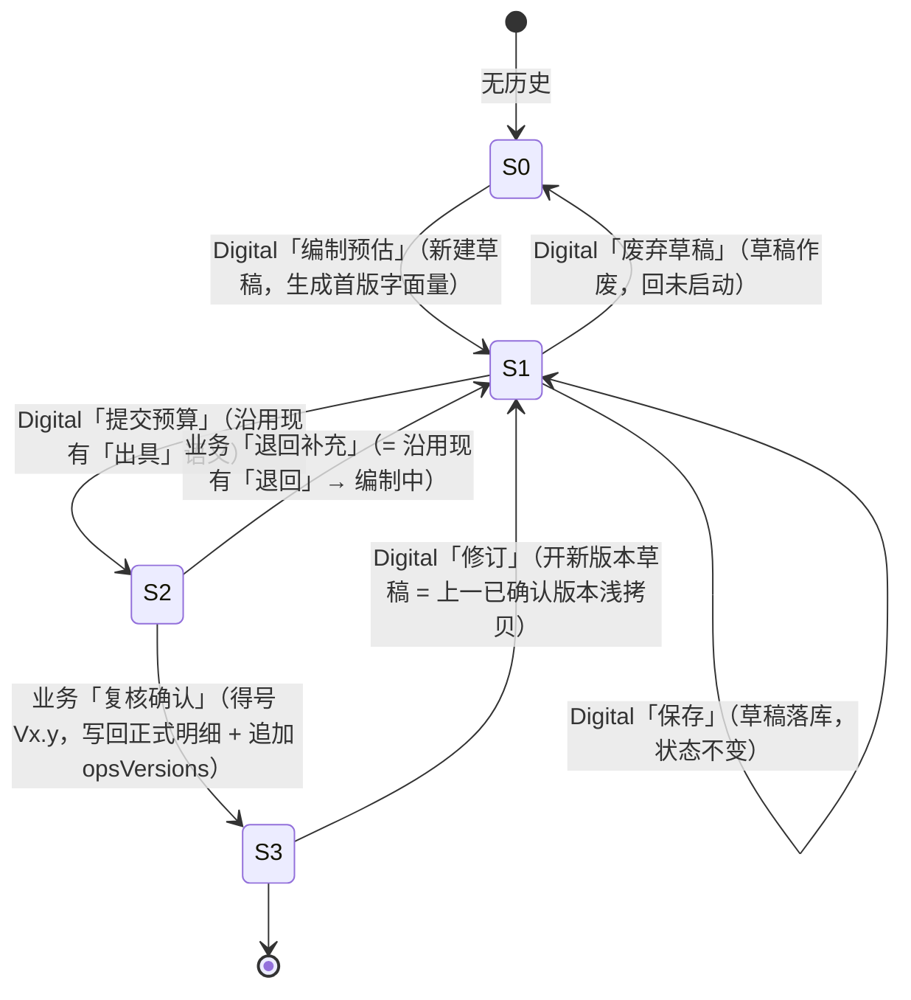

# v1.1 《系统运维预算计划》独立页面 · 需求描述与设计说明（Brief）

> 本文件是**需求描述文档（Design Brief）**，不是实现文档。目的：把用户口述的 6 点需求形式化，逐条判定「理解准确 / 需修正 / 需澄清」，收敛歧义，输出可直接交给研发的需求基线。
> 本轮**只产出文档，不改任何源码**（`src/**` 一字未动）。文中所有"现状"均以当前代码为准，行号取自 `src/pages/BudgetModule.jsx`、`src/pages/ProjectBudgetPage.jsx`、`src/store.jsx`、`src/domain/calc.js`、`src/App.jsx`、`src/data/mock.js`；与代码不符处以代码为准。
> 体例沿用 v0.8：结论前置 → 逐条判定 → 页面结构 → 字段规范 → 状态机 → 版本留痕 → 待拍板 → 差异清单（精确到 `文件:行号`）→ 名词表。
> 上一轮 v0.8 处理「② 项目预算」、v0.9/v1.0 处理「① 年度 BP」的页面化；本轮处理「③ 系统运维预算」。三者是同一主表的三个下钻兄弟，形态应统一，但**状态机不可照搬**（见 §5.4）。

---

## 修订记录

| 轮次 | 日期 | 内容 |
|---|---|---|
| 首版 | 2026-10-03 | 用户 6 点需求形式化；输出 §1 逐条判定 + §4 字段与恒等式验算 + §5 状态机映射 + §7 数据模型缺口 + §9 待拍板（6 项）。**未改源码。** |
| 第二轮 | 2026-10-02 | 用户拍板 5 项（Q1–Q5）定稿；路径改**四段**；`opsVersions` 升级为**完整明细快照**。凡与首版推荐相反处，均标注「未采纳推荐」并给出新方案理由与代价。 |

---

## 结论前置（5 条最关键的判断）

1. **最大的结构性缺口：OPS 现状只有"计划头"，没有可编辑、可留存的系统级明细。** `OPS_PLANS`（`mock.js` 530–539 行）每个部门一条记录，字段只有 `id / fy / dept / version / status / digitalOwner / bizOwner / issueDate / confirmDate / files / note` —— **没有任何一行"某系统 × 用量 × 金额"**。页面主体要的"每行一个系统"表格，其内容**完全由 `calc.opsPlanBySystem` 实时派生**（`calc.js` 503–514 行），既不落库、也无版本、更不可编辑。因此用户第 4 点"整表管理（编辑、保存、更新）"**在当前数据模型下无法实现**，必须新增「可编辑的明细行 + 草稿 + 版本快照」三件套。这是本轮唯一的模型级阻断项。

2. **用户第 4 点说的"与项目需求清单列表的管理方式类似"，只应照搬"整表一个版本"的机制，不能照搬其流程方向。** 需求清单（v0.8）是四段流程「**业务**编辑 → 提交 → **Digital** 反馈费用 → **业务**复核确认」，得号在最后一环；OPS 是两段流程「**Digital** 提交预算 → **业务**复核确认」（用户第 5 点原文），**编辑方与确认方正好互换**。可以照搬的是：① 整表为一个版本（不做逐条版本）；② 草稿/进行中内容与正式版本隔离（`demandDrafts` 的"除确认外不动正式数据"纪律，`store.jsx` 289–305 行注释）；③ 唯一写回点 = 业务复核确认；④ 统一流水留痕。**不可照搬**的是：草稿的发起角色（这里是 Digital）、编辑权限列、得号时机（§5.4）。

3. **状态机无需新增状态**：用户第 5 点的两段流程与现有 `OPS_PLANS.status` 四态（`未启动 / 编制中 / 待业务确认 / 已确认`）**一一对应**——"Digital 提交预算" ≡ 现有 `出具` 动作（`store.jsx` 212–213 行 → `待业务确认`），"业务复核确认" ≡ 现有 `复核确认` 动作（`store.jsx` 215 行 → `已确认`）。缺口**不在状态、在数据与留痕**：现有 `planAction` 的 OPS 分支只改头部状态字段，没有"保存草稿"、没有版本内容快照（见 §5 / §7）。**已定稿**：得号时机后移到「业务复核确认」（Q4，§5.4）。

4. **⚠️ 必须显式写清的两条代价（均系用户知情后拍板，不是漏做）：**

   **(a) 用量可人工编辑 ⇒ 编制年度预算与执行年度账单脱钩。** 现状 `opsPlanBySystem`（编制口径，`calc.js` 503–514 行）与账单月度核销（执行口径，`calc.js` 127–135 行 `opsLineAmount`）**共用同一套 `opVolume` 计费模型**，仅差一个部门增长系数（`calc.js` 505 行）——这是当前"预算 = 账单年化"能被核对的前提。允许 Digital 手改「年度 BU 用量」后，编制预算由"模型派生"变为"人工输入"，执行账单仍按实际用量 × 单价计算，**两者从"同源"变为"两套数"**。这不必然是坏事（计划 vs 实际本就该分离），但**必须**：① 页面显式区分「编制口径 / 执行口径」；② **严禁**把人工编辑的计划用量写回 billing 的计算路径（否则等于篡改历史账单计算基线）。**本项不粉饰、不隐藏。**

   **(b) 单价可编辑（Q1 定稿）⇒ 打破 `DESIGN.md` 既有的「费率表按年度锁定、全年不调价」口径。** `DESIGN.md` **110–112 行**（§2.3「费率预算期锁定，全年不调价」）与 **49 行**（能力映射「费率**预算期锁定、全年不调价**」）明确：Rate Card 在预算期一次性确定、全年不变。**Q1 允许在运维计划页改单价，是对该口径的知情豁免**。豁免边界必须收死：单价编辑**只作用于编制口径** `opsPlans[].items[]`，**绝不回写** `SYSTEMS`（`mock.js` 89–98 行）或 `VOLUME_BASE`（`mock.js` 101–110 行），否则等于改了全平台的计费真相源与历史账单基线（§7.4）。该口径冲突另见 §9-Q6、§10 差异 17–19。

5. **5 列里的「年度 BU 用量」量纲各异，Q2 已定稿为"使 `单价 × 用量 = 年度总费用` 成立的有效用量"（含增长系数）。** 经实算（§4.4）：`order` = 全年订单量（单/年）、`member` = 全年"千人·月"合计、`fixed` = 份额 × 增长系数（**显示为「1.04 份」，写"份"不写"104%"**）。同时**编辑纪律写死**：增长系数只在**首次生成清单时折进"用量"一次**，此后人工每次编辑**不再二次叠加**（否则改一次用量就被乘一遍，费用莫名放大）——该纪律由「首次生成即固化为字面量」保证，不靠运行时判断（§4.4 / §4.5）。

---

## 一、需求逐条判定表

> 复述用户原文（本轮唯一输入），逐条给出判定与实现落点。判定档：**准确 / 需修正 / 需澄清**。

| # | 用户原文 | 判定 | 理由 | 实现落点 |
|---|---|---|---|---|
| 1 | 页面主体是一个列表 | **准确** | 现状 OpsPanel 的主体是 `Descriptions`（计划头）+ 附属 Table（`BudgetModule.jsx` 1156–1237 行）；新需求要求**主体是系统明细列表**（列表升为主体，计划头降为概览）。 | §3.3 楼层 2 |
| 2 | 列表每一行是一个这个 BU 需要付费的系统 | **准确**，但有隐含边界 | `opsPlanBySystem` **会过滤掉金额为 0 的系统**（`calc.js` 512 行 `.filter(r => r.amount > 0)`）。因此"该 BU 需要付费的系统"= 计费模型下年化金额 > 0 的系统，**不是** `SYSTEMS` 目录（8 个）的全集。行数随 BU 不同（1–4 个，见 §4.4 实算）。 | §3.3；数据源 `opsPlanBySystem` |
| 3 | 列：系统名称 / 计费方式 / 单价 / 年度 BU 用量 / 年度总费用 | **需修正 1 处**（补 1 处必需信息） | 5 列方向正确，但"系统名称"若只放名称，**无法区分子系统/定位到系统目录**——建议名称列**主行名称 + 副行「系统ID · 所属线」**（沿用现状 `OpsPanel` 做法，`BudgetModule.jsx` 1191–1198 行）。"年度 BU 用量"量纲需按计费方式区分并明示（§4.4）。 | §4.1 字段规范 |
| 4 | 该列表的版本管理方式，与项目需求清单列表类似，即整表管理（编辑、保存、更新），而非逐项管理 | **需修正 2 处** | ① "整表管理"= 整表为一个版本（与需求清单一致），**须新增草稿 + 版本机制**（现状 OPS 无）；② 但流程方向与需求清单**相反**（Digital 编制、业务确认），**不可照搬**需求清单的四段流程与得号时机。**已定稿**：编辑对象含"年度用量 + 单价"（Q1），进行中版本用独立四段路由（Q3）。 | §5 状态机；§7 数据模型 |
| 5 | 维护流程：Digital 提交预算，业务复核确认，则标记为已确认 | **准确**（与现状动作一一对应） | "Digital 提交预算" ≡ 现有 `出具`（`store.jsx` 212–213 行，`编制中/未启动 → 待业务确认`）；"业务复核确认" ≡ 现有 `复核确认`（215 行，`待业务确认 → 已确认`）。**已定稿（Q4）**：得号从"出具时"后移到"业务复核确认时"，与需求清单统一。 | §5.1 / §5.4 |
| 6 | 所有确认更新，都需要被记录 | **需修正**（现有留痕不足） | `planActivities` 已记录"出具 / 复核确认 / 退回"**事件**（`mock.js` 549–585 行；`store.jsx` 236 行 `log`），但**只记事件、不记内容**。且 **Q1 单价可编辑后，若版本只记合计，"上一版 SYS-04 的单价与用量"将永久丢失**——审计链断裂。**已定稿**：`opsVersions[]` 存**完整明细快照**（Q4 带出的升级，§6.2）。 | §6 版本与留痕 |

---

## 二、页面定位与入口变更

### 2.1 从浮层到独立页面（两段式路由）

现状：主表「③ 系统运维预算」格 → `setCtx({stage:'OPS', dept})`（`BudgetModule.jsx` 462 行）→ 右侧 Drawer 渲染 `OpsPanel`（挂载于 677 行，组件体 1137–1262 行）。
目标：该下钻改为**独立页面**，且**进行中版本用独立四段路由**（Q3 定稿），获得 URL、可刷新、可分享、可后退 —— 与 v0.8《项目预算计划》、v1.0《年度 BP 计划》一致。

| 项 | 方案 |
|---|---|
| 路由 key | **新增 `opsplan`**（与 `bpplan` 对称；**已核实** 不与任何现行/旧视图重名） |
| 正式版路径 | **`#/budget/opsplan/{deptCode}`**（= 正式版本只读视图），如 `#/budget/opsplan/D-RETAIL` |
| 进行中路径 | **`#/budget/opsplan/{deptCode}/new`**（= 进行中版本编辑 / 查看视图） |
| 注册位置 | `App.jsx` `MODULE_VIEWS.budget`（37–43 行）**只增 `{key:'opsplan', label:'系统运维预算计划'}`一个 key**；**第四段 `new` 不注册** |
| 为什么必须注册 sub | 未注册时 `App.jsx` 178–185 行的归一 effect 会把 `#/budget/opsplan/...` 直接 `replace` 成 `#/budget/annual`，页面**根本进不去** |
| **为什么第四段不必注册（已实读 178–185 行确认）** | 归一 effect 的守卫只读 `seg` 与 `sub`：`const noOrInvalidView = !sub \|\| !MODULE_VIEWS[seg].some((v) => v.key === sub);`（181 行），依赖数组亦为 `[seg, sub]`（185 行）——**`tail` 从不参与判断**。故 `#/budget/opsplan/D-RETAIL/new` 的 `sub='opsplan'` 合法，**不会因 `tail='new'` 被 replace**。 |
| 路由段位 | **必须用第四段 `tail`**。`useHashRoute`（`App.jsx` 84–101 行）已解析 `[seg, sub, param, tail]`；`go(module, view, param, tail)`（197–203 行）已按四段拼接。**现成先例**：`ProjectBudgetPage.jsx` 7 行即用 `tail='new'` 承载「进行中版本视图」，`BudgetModule.jsx` 2322 行把 `tail` 透传给该页 |
| `MODULE_DEFAULT_VIEW` | **不改**（仍为 `annual`） |
| `SiderNav` | **不改**。`SiderNav` 用自己硬编码的 `GROUPS`（与 `MODULE_VIEWS` 解耦），新增 view 不会进左导航——下钻页本就不该占一级导航 |
| 面包屑 | **自动生效**，复用 `App.jsx` 309–337 行定位条：`#/budget/opsplan/D-RETAIL` → 「预算管理 · 编制与消耗 › 系统运维预算计划 › D-RETAIL」；带 `tail` 时末段追加「› 新版本」（`App.jsx` 331–336 行已实现该分支） |
| 编制年 | 必须用 `PLAN_FY = 2027`（`BudgetModule.jsx` 73 行），**不可用 `globalFy`**。理由同 v0.8/v0.9：年度预算计划恒为次年编制口径，`globalFy` 可切到 2026 执行年，会造成"点进去看到另一年份"的错位 |
| 模块壳挂载 | `BudgetModule.jsx` 2311–2326 行的 `BudgetModule` 开关增 `{view === 'opsplan' && <OpsBudgetPage deptCode={param} tail={tail} onNavigate={onNavigate} />}`（与 `project` 分支 2322 行同构） |

### 2.2 进入 / 退出路径

| 方向 | 路径 | 现状入口 |
|---|---|---|
| 进入①（主入口） | 主表 → 部门行「③ 系统运维预算」格 → `#/budget/opsplan/{deptCode}` | `BudgetModule.jsx` 446–463 行 `PlanCell.onClick` |
| 进入②（操作列） | 主表「操作」列"更新"按钮（`next.stage==='OPS'`）→ 同 URL | `BudgetModule.jsx` 495–511 行（当前走 `openAction` → `PlanActionModal`） |
| 进入③（综合视图） | SUMMARY 抽屉「③ 系统运维预估费用」卡片 → 同 URL | `BudgetModule.jsx` 994–1000 行卡片 + 654–666 行 `onOpen` |
| 进入④（进行中入口） | 正式版视图列表上方**进行中徽标** → `#/budget/opsplan/{deptCode}/new` | 新增（参考 v0.8 §6.2；是否存在进行中版本由 `opsDrafts` 推导） |
| 退出 | 正式版页头「返回年度预算计划」→ `#/budget/annual`；`/new` 页头「返回」→ 正式版路由；浏览器后退同样有效 | 新增 |

> **三处主入口必须一并改跳独立页**，否则会出现"同一编制项两个入口、两种形态"（点格进页面、点卡片还开浮层）。这是 v0.9 §1-1.4 已经踩过的坑（§8 逐个给出落点）。

### 2.3 `/new` 空态兜底（**照抄 v0.8 写法**）

`#/budget/opsplan/{deptCode}/new` 被直接打开、但**不存在进行中版本**时（刚复核确认完 / 已废弃 / 手输 URL）→ **不得白屏**：

- `setTimeout(0)` 后 `window.location.replace('#/budget/opsplan/{deptCode}')` 回三段，并 inline 提示「当前无进行中版本，已返回正式版本视图」。
- **为什么用 `setTimeout(0)` 而非同步 replace**：让"进入编辑"的 `startOpsDraft` 先落库，避免**同帧竞态**把刚创建的草稿误判为空态（`ProjectBudgetPage.jsx` 87–102 行即此写法与理由，本轮直接照抄）。

### 2.4 与 v0.8 / v1.0 下钻页的形态对齐

| 项 | ② 项目预算（v0.8） | ① 年度 BP（v1.0） | ③ 系统运维预算（本轮） |
|---|---|---|---|
| 路由 key | `project` | `bpplan` | **`opsplan`** |
| 是否有独立进行中路由 | 有（`/new`） | 无 | **有（`/new`，Q3 定稿）** |
| 列表粒度 | 一行 = 一条项目（需求） | 一行 = 一个版本 | **一行 = 一个系统** |
| 状态机态数 | 6（S0–S5） | 2（未提交/已提交） | **4**（未启动/编制中/待业务确认/已确认） |
| 整表版本 | 是 | 是（但每行一个版本） | **是（每行一个系统，整表一个版本）** |
| 主操作入口 | 页面按钮（随状态） | 「修正年度 BP」浮层 | **页面按钮（随状态）+ 整表编辑态** |
| 编制方 / 确认方 | 业务编制 / Digital 费用 / 业务确认 | 业务单方 | **Digital 编制 / 业务确认** |
| 可编辑列 | 业务改项目内容；Digital 改费用 | 无（版本不可变） | **年度用量 + 单价**（Q1） |

> 三者共用"下钻页壳"（页头 `PageHead` + 返回按钮 + `BlockTitle` 列表标题行），但 OPS 是**唯一"整表可编辑（含单价）+ 双向流程"**的下钻页。建议抽取共用壳组件（沿用 v0.9 §10 差异 17）。

---

## 三、页面结构规范

页面自上而下 4 个楼层。命名与现有组件对齐（`PageHead` / `Metric` / `Alert` / `Table` / `BlockTitle` / `Blank` 均取自 `components/common.jsx`）。

### 3.1 楼层 0 · 页头（PageHead）

- 标题：`{部门名} · 系统运维预算计划`
- 副说明（一句话口径）：`按系统计费模型（订单量 / 会员规模 / 固定年费）年化出具；整表为一个版本，Digital 提交 → 业务复核确认后生效。`
- `extra`：
  - **返回按钮**（`ArrowLeftOutlined`，`type="text"`）→ `#/budget/annual`
  - **主操作按钮**（随状态变化，见 §5.3）：`编制预估` / `保存` / `提交预算` / `业务复核确认` / `退回补充`
- 责任人信息行（12px，`t3`）：`Digital 出具人 {digitalOwner} · 业务复核人 {bizOwner}`
- `data-testid="budget-ops-plan-page"`

### 3.2 楼层 1 · 概览楼层（3 张卡）

用户未明确要概览卡，但"版本管理"必须让人一眼看到**当前版本 / 状态 / 年度总费用**。与需求清单页（v0.8 用 2 卡）同构，取 3 卡承载 OPS 特有的"状态 + 双责任人"：

| 卡 | 主值 | 副行 | 数据来源 | tone |
|---|---|---|---|---|
| 当前版本 | 版本号（`Vx.y`），无则「待出具」 | 状态 + 出具/确认时间 | `opsPlan.version / status / issueDate / confirmDate` | 已确认=success，其余=warning |
| 年度总费用 | `fmtWan(totalAmount)` 万元 | `${itemCount} 个系统` | 已确认版本明细合计（无则回退模型派生） | warning |
| 计费口径 | `3 种计费方式`（或按该 BU 实际种类数） | `业务量增长系数 ${opsGrowth} 已折入用量` | 明细行 billing 去重 + `dept.opsGrowth` | default |

- `data-testid="budget-ops-overview"`。
- **不新增「状态」独立卡**：状态是版本的属性（与 v0.8 §3.2 同源）。

### 3.3 楼层 2 · 主体：系统明细列表

- 容器 `data-testid="budget-ops-table"`（由抽屉内表格升级页面主体）。
- 列定义见 §4（**5 业务列**；编辑态追加「操作」列）。
- **只读性随状态与路由**：

  | 路由 / 状态 | 可编辑 | 说明 |
  |---|---|---|
  | 正式版 `.../{dept}`（已确认） | 恒只读 | 正式版本不可变 |
  | 正式版（待业务确认） | 只读 | 业务复核用 |
  | `/new`（S1 编制中）+ Digital | **整表可编辑** | 改年度用量、改单价、增删行 |
  | `/new`（S2 待业务确认） | 只读 | 已提交等业务复核 |

- **整表编辑的交互范式**：本地 `items` 缓冲，**不在 `onChange` 里直接写 store**（照抄 `ProjectBudgetPage.jsx` 76–85 行）；点「保存」写 `opsDrafts`，点「提交预算」推进状态。
- 合计行：`footer`/`summary` 沿用现有做法（"共 N 个系统" + "合计 X 万元"，`BudgetModule.jsx` 1227–1232 行）；合计口径 = 明细行 `年度总费用` 之和，与列内**严格同源**。
- 空态：`Blank`，文案「该部门本年度无运维计费系统 / 尚未编制，点击「编制预估」开始」。
- `data-testid="budget-ops-table"`。

### 3.4 楼层 3 · 统一模块：版本与操作流水

对应需求第 6 点。与 v0.8 §3.5「统一流水」同构：**版本快照**（`opsVersions`）与**操作留痕**（`planActivities` 过滤 `stage==='OPS'`）合并为一条按时间倒序的流水。

**形态：单张 `Table`（流水表），而非 antd `Timeline`**（理由同 v0.8 §3.5：需承载多字段、按时间倒序、后续可筛选）。

| 列 | 内容 | 来源 |
|---|---|---|
| 时间 | 事件时间 | `opsVersions.at` ∪ `planActivities.at` 并集排序 |
| 版本号 | `Vx.y`；草稿/进行中为「—」 | `opsVersions.version`（草稿态无值） |
| 状态 | 编制中 / 待业务确认 / 已确认 / 已退回 | `opsVersions.status` |
| 动作 | 保存草稿 / 提交预算 / 业务复核确认 / 退回补充 / 废弃 | 归一动作词 |
| 操作人（角色） | `顾晓东（Digital）` / `陈昊（业务部门）` | `actor` + `role` |
| **明细** | 「查看」（打开该版本完整系统明细） | 见 §3.6 |
| 变更说明 | 本次说明 | `changeNote` / `note` |

- `data-testid="budget-ops-timeline"`。

### 3.5 楼层 3 的「查看版本明细」浮层（**需要，用 `Drawer` 承载**）

**结论：需要。** 理由：流水行只承载版本头（版本号 / 状态 / 合计 / 系统数）。一旦单价可编辑（Q1），"上一版某个系统的单价与用量"是审计核心，必须能就地展开查看，否则又回到"看得到合计、看不到组成"的老问题。

- 承载组件：antd `Drawer`（`open` + `title` + `width`），内容为只读 `Table` + 顶部版本头 `Descriptions`。
- **antd 版本与废弃 API 硬门控（已核实）**：本项目 antd 版本 **5.29.3**（`node_modules/antd/package.json`）。`Drawer.destroyOnClose` 自 5.25.0 起**已废弃**（改用 `destroyOnHidden`），本项目**有过因运行期 antd 废弃告警被冒烟断言判 FAIL 的先例**。⇒ **禁止使用 `destroyOnClose`**；如需销毁内容用 `destroyOnHidden`（5.25+ 可用）；如无必要则不写销毁属性。现成安全先例：`ProjectBudgetPage.jsx` 617 / 627 行的 `Drawer open={...}` 均未使用 `destroyOnClose`，照此即可。
- 浮层内明细列与楼层 2 只读态一致（5 列），另加一行"本版合计"。

### 3.6 data-testid 命名总表（增 / 改 / 删）

| 动作 | testid | 说明 |
|---|---|---|
| 新增 | `budget-ops-plan-page` | 页面根容器 |
| 新增 | `budget-ops-overview` | 概览楼层 |
| 新增 | `budget-ops-table` | 系统明细列表（主体） |
| 新增 | `budget-ops-timeline` | 版本与操作流水 |
| 新增 | `budget-ops-version-detail` | 版本明细浮层（Drawer）根节点 |
| 新增 | `budget-ops-inprogress` | 正式版视图的"进行中"入口徽标 |
| 新增 | `budget-ops-edit` / `budget-ops-save` / `budget-ops-submit` / `budget-ops-confirm` / `budget-ops-reject` / `budget-ops-discard` | 主操作按钮 |
| 新增 | `budget-ops-usage-{sysId}` / `budget-ops-rate-{sysId}` | 年度用量 / 单价输入框（编辑态） |
| 保留 | `budget-annual-cell-ops-{deptCode}` | 主表入口格（**渲染不变，仅 `onClick` 改跳页**） |
| 移除 | `budget-annual-ops-drawer` | 浮层取消（OPS 分支，`BudgetModule.jsx` 1142 行） |

> **测试同步**：**已核实现有测试从未断言 `budget-annual-ops-drawer`**（全库 grep 无匹配），故该 testid 移除**不使任何既有断言失效**。详见 §10.1。

---

## 四、列表字段规范

### 4.1 字段逐一定义（定稿：5 业务列；编辑态追加 1 操作列）

**列顺序固定为：** `系统名称 | 计费方式 | 单价 | 年度 BU 用量 | 年度总费用（万元）`（编辑态末位追加 `操作`）。

| # | 字段名 | 类型 | 取值 / 枚举 | 数据来源（映射） | 可编辑 | 空态文案 | 列宽 / 对齐 |
|---|---|---|---|---|---|---|---|
| 1 | 系统名称 | string | 系统主数据名 | `sys.name`（主行）+ `sys.id · sys.line`（副行 11px `t3`） | **否**（主数据） | —（恒有） | 260 / 左 |
| 2 | 计费方式 | enum | `按订单量` / `按会员规模` / `固定年费` | `sys.billing`（`BILLING_MODE_LABEL`，`BudgetModule.jsx` 76 行） | **否** | — | 120 / 左（`Tag`，`marginInlineEnd:0`） |
| 3 | **单价** | number + 单位 | `order` 2 位小数 / `member` 整数或 1 位 / `fixed` 整数元 | `sys.rate` + `sys.unit`（**Q1 定稿：可编辑**） | **是（编制中 · Digital）** | — | 170（只读）/ 205（编辑，含单位后缀）/ 右 |
| 4 | **年度 BU 用量** | number + 单位 | 见 §4.4（= 使 `单价 × 用量 = 总费用` 成立的有效用量） | **新增**（已确认明细 / 草稿）；未启动时回退 `opVolume` 派生 | **是（编制中 · Digital）** | `—` | 210（只读）/ 220（编辑）/ 右 |
| 5 | 年度总费用（万元） | number（万元，1 位小数） | ≥0 | 明细行 `amount`；`= 单价 × 用量` | **否（派生，不可编辑）** | `—` | 160（只读）/ 150（编辑）/ 右 |
| 6 | 操作（**仅编辑态**） | — | 删除行 | — | — | — | 88 / 右；表上方另放「+ 添加系统」按钮 |

- 金额统一以**万元**展示（`fmtWan`），底层存**元**。
- **「同一信息不说两遍」的两处判定**：
  - **不新增「版本」列**。整表为一个版本，版本号对每行都相同 —— 放进每行 = 重复 N 遍。版本号放**页头/概览卡**（§3.2），与需求清单页（v0.8 无版本列）一致。
  - **不新增「系统ID / 所属线」独立列**。改为"系统名称"列**副行**（`SYS-04 · 门店数字化`），保留现状信息量（1191–1198 行）又不占列宽。
- **单位位置口径（与 Phase 2 规范 §12-C1 对齐）**：**金额类列表头带单位、单元格纯数字** —— 沿用 `OpsPanel` 1220 行「年度预估（万元）」+ 1217/1224 行单元格 `fmtWan(v)`（纯数字）、`ProjectBudgetPage` 300 行「业务预估（万元）」+ 316 行纯数字的既有做法。**两处例外**：`单价` 与 `年度 BU 用量` 两列的**单位逐行随计费方式变化**（`元/单`、`元/千人/月`、`元/年` 与 `单/年`、`千人·月/年`、`份`），无法进表头，单位必须落在单元格内（沿用 `OpsPanel` 1202 行「单价」+ 1208 行单元格带单位）。
  > 澄清一处易混点：**主表格** `budget-annual-cell-ops-*` 的"万元"小字后缀是 `PlanCell` 构件的既有做法（且有测试断言 `smoke.cjs` 267/330/336 行），**与本页列表列的单位口径无关**；团队简述里的 `722.4 万元` 指主表格，不是本页列表列。
- **只读列（系统名称 / 计费方式）不得编辑**：二者是系统主数据（`SYSTEMS`），属全平台唯一真相源；在此可编辑会与账单/计费规则模块产生第二份真相（同 v0.9 §5.3）。
- **可编辑列 = 年度 BU 用量 + 单价（Q1 定稿，未采纳首版"仅用量"推荐）**：
  - 首版推荐「仅用量可编辑」（理由：单价属费率表、锁年度），**用户未采纳**，改为二者皆可编辑。
  - **理由（用户口径）**：编制期需按 BU 实际情况议定运维单价，锁死单价会让"整表管理"名不副实。
  - **代价（写入 §7.4 与 §10）**：与 `DESIGN.md` 110–112 / 49 行「费率预算期锁定、全年不调价」口径冲突（知情豁免）；且单价一旦可改，版本快照必须存完整明细（§6.2），否则审计链断裂。
  - **铁律**：单价编辑**只写入编制口径** `opsPlans[].items[].rate`；**绝不回写** `SYSTEMS`（`mock.js` 89–98 行）或 `VOLUME_BASE`（`mock.js` 101–110 行）。

### 4.2 列宽预算（显式计算链，不写魔法数）

**可用宽度核算链（Sider 展开态）：**

```
视口 − 竖向滚动条 15 − Sider 224 − Content 左右 padding 48 − Card body padding 32 − 边框 2
```

| 视口 | 可用宽 |
|---|---|
| 1440 | 1440 − 15 − 224 − 48 − 32 − 2 = **1119** |
| 1366 | 1366 − 15 − 224 − 48 − 32 − 2 = **1045** |
| 1280 | 1280 − 15 − 224 − 48 − 32 − 2 = **959** |

> 核算链与 v1.0 文档 §4.2 完全一致（1119 已被既有实现验证），非本轮新造。Sider 折叠为 64 时各视口再 +160。

**只读态（5 列）：合计 = `scroll.x` = 920**

| 列 | 宽 |
|---|---|
| 系统名称 | 260 |
| 计费方式 | 120 |
| 单价 | 170 |
| 年度 BU 用量 | 210 |
| 年度总费用（万元） | 160 |
| **合计** | **920** |

- 1280：920 < 959 → **不横滚**（余 39）；1366 / 1440 更宽，不横滚。

**编辑态（6 列，单价/用量加宽以容纳 `InputNumber` + 单位后缀）：合计 = `scroll.x` = 1023**

| 列 | 只读宽 | 编辑宽 | 加宽理由 |
|---|---|---|---|
| 系统名称 | 260 | 250 | 编辑态回收 10px 让给输入列 |
| 计费方式 | 120 | 110 | 同上 |
| 单价 | 170 | **205** | antd `InputNumber` 默认约 90px，加 `addonAfter`（`元/单`、`元/千人/月`）需再 +70~100px |
| 年度 BU 用量 | 210 | **220** | 需容纳 7 位整数（如 `16,226,950`）+ 单位后缀 `单/年` |
| 年度总费用（万元） | 160 | 150 | 派生只读，可收 10px |
| 操作 | —（不渲染） | 88 | 仅删除行 |
| **合计** | **920** | **1023** | |

- 1440：1023 < 1119 → **不横滚**（余 96）
- 1366：1023 < 1045 → **不横滚**（余 22）✅
- 1280：1023 > 959 → **横滚约 64px**（编辑态为临时态，可接受）

> 取舍：编辑态 1280 屏会出现约 64px 横向滚动，换来 1366 主流屏不滚 —— 与 v0.8 方案 B 的取舍同源（优先保 1366）。若采纳 §9-Q2 的"追加增长系数列"等建议，需重新核算。

### 4.3 各列对齐

- 文本列（系统名称）：左对齐，`ellipsis` + 原生 `title`。
- 枚举列（计费方式）：左对齐（`Tag` 左缘对齐，避免短标签居中后与表头脱节）。
- 数值列（单价 / 用量 / 年度总费用）：**右对齐**，`fontVariantNumeric: 'tabular-nums'`（与现状 OpsPanel 1205/1217/1224 行一致，保证逐行数字对齐可扫）。

### 4.4 「年度 BU 用量」量纲与恒等式（**已定稿：有效用量含增长系数**）

**定稿定义（写死）：**「年度 BU 用量」= **使 `单价 × 用量 = 年度总费用` 成立的有效用量**。

| 计费方式 | 用量定义 | 单位 | 计算式 |
|---|---|---|---|
| `order` | 全年订单量（含增长系数） | 单 / 年 | `Σ(12 月 opVolume) × 增长系数` |
| `member` | 全年"千人·月"合计（含增长系数） | 千人·月 / 年 | 同上（`opVolume` 为"千人/月"） |
| `fixed` | 份额 × 增长系数 | **份** | `(dept 权重 / 总权重) × 增长系数` |

- **`fixed` 的展示口径（Q2 定稿）**：显示为 **「1.04 份」而不是「104%」**。理由：`fixed` 已含增长系数，用百分比会被误读成"份额超 100%"；用「份」承载，单元格 `title` 写明口诀：**「BU 份额 100% × 业务量增长系数 1.04 = 1.04 份」**。
- 由此 `order / member / fixed` 三类的 `单价 × 用量 = 年度总费用` **在表内逐行成立**，读者可手算复核。

**实算验算**（当前 `mock.js` + `calc.js`，脚本直跑 `opsPlanBySystem`，`diff` 均为 0）：

| BU | 系统 | 计费方式 | 单价 | 有效用量（含增长） | 单价 × 用量 = 年度总费用 |
|---|---|---|---|---|---|
| D-RETAIL | SYS-04 门店 POS 与库存 | order | 0.42 元/单 | 17,200,567 单/年 | 0.42 × 17,200,567 = **7,224,238** |
| D-CRM | SYS-03 会员与 CRM 平台 | member | 42 元/千人/月 | 112,760.5 千人·月/年 | 42 × 112,760.5 = **4,735,941** |
| D-FIN | SYS-07 数据仓库与 BI | member | 6.5 元/千人/月 | 11,424 千人·月/年 | 6.5 × 11,424 = **74,256** |
| D-SVC | SYS-08 客服工单系统 | fixed | 960,000 元/年 | **1.15 份** | 960,000 × 1.15 = **1,104,000** |

> 上表"有效用量"= 未含增长的年化量 × 增长系数（D-RETAIL 16,226,950 × 1.06 = 17,200,567；D-CRM 103,450 × 1.09 = 112,760.5；D-FIN 11,200 × 1.02 = 11,424；D-SVC 份额 1.00 × 1.15 = 1.15）。D-RETAIL 的 `0.42 × 17,200,567 = 7,224,238.14`，展示时按元四舍五入为 7,224,238。

**编辑纪律（硬约束，写进页面与 §4.5）：**

> **增长系数只在"首次生成清单"时折进「用量」一次，此后人工每次编辑都不再二次叠加。**

- 若靠运行时判断"是否已含增长"，极易在第二次编辑时重复相乘，用户会看到费用莫名放大。
- ⇒ **由"首次生成即固化为字面量"保证**：`编制预估`（`startOpsDraft`）生成首版时，一次性把 `opVolume 年化 × 增长系数` 算成**字面量**写入 `opsDrafts.items[].usage`；此后 `saveOpsDraft` / 编辑**只做覆盖写，不做乘法**。`fixed` 同理（首版写入 `1.15` 份的字面量）。

**与首版的三处偏差来源（改写为定稿口径）：**

1. ~~增长系数（决策点）~~ → **已按含增长系数展示**（`order/member` 的用量已折入增长系数，恒等式成立）。
2. **`fixed` 的份额不可被理解为百分比超限** → 保留该项，改用「份」承载（如上）。
3. **月度舍入 + 0 值过滤（保留）**：`opVolume` 每月四舍五入到 50（`calc.js` 123 行），`opsPlanBySystem` 过滤金额为 0 的系统（512 行）。⇒ **首版用量（模型生成、逐月舍入）× 增长系数** 与 **人工后续输入（整年字面量）** 天然不会逐位相等 —— 这是"人工首版生成走模型、之后走人工字面量"的**固有差异**，页面口径说明须标注。

**各 BU 实际行数与金额**（当前 mock，FY2027 实算）：

| BU | 增长系数 | 系统数 | 年度总费用 |
|---|---|---|---|
| D-RETAIL | 1.06 | 3 | 830.8 万 |
| D-ECOM | 1.12 | 4 | 659.2 万 |
| D-MKT | 1.05 | 4 | 436.5 万 |
| D-CRM | 1.09 | 2 | 549.1 万 |
| D-SCM | 1.04 | 3 | 375.4 万 |
| D-SVC | 1.15 | 2 | 125.4 万 |
| D-FIN | 1.02 | 1 | 7.4 万 |
| D-HR | 1.00 | 1 | 5.7 万（未出具） |
| **合计** | | 20（去重 8 系统） | **2,989.6 万** |

### 4.5 编辑态校验规则（**新增章节；用户未提，但不写就会做出可提交的脏数据**）

| 字段 | 规则 | 依据 |
|---|---|---|
| 单价 `rate` | `> 0`；小数位按计费方式：`order` **2 位**（如 0.62）、`member` **整数或 1 位**（如 42 / 6.5）、`fixed` **整数元**（如 960000）。超位按计费方式舍入到允许位 | 现状 `SYSTEMS.rate` 取值即此形态（`mock.js` 90–97 行） |
| 年度 BU 用量 `usage` | `order` / `member`：**≥ 0，至多 1 位小数**；`fixed` 的「份」：**`> 0`，至多 2 位小数** | 见下方「用量精度」说明；不得取整（取整会破坏 §4.4 恒等式） |
| 年度总费用 `amount` | **由 `rate × usage` 推导，不可直接编辑**；`= round(rate × usage)`（元） | 保证"合计与列内同源"、防手改金额造成表内不自洽 |
| 空表（0 行） | **允许保存草稿，禁止提交预算**。理由：编制中允许"先清空再逐条加"；但 0 系统的运维预算无业务意义，不应进入"待业务确认" | 参考需求清单草稿允许空、复核确认要求非空 |
| 删除最后一行 | **允许删除，但删除后若为 0 行则提交按钮禁用**（同"空表"规则）。不设"禁止删最后一行"的硬拦截，避免用户卡死在无法操作的编辑态 | 以"提交门禁"替代"编辑拦截" |
| 行内不合法 | **不允许提交**：非法行 `status="error"` + 底部提示"N 行未通过校验"，提交按钮 `disabled` | 与 v0.8 `ProjectBudgetPage` 的"编辑缓冲 + 提交前校验"一致 |
| 校验时机 | **行内即时校验（`onChange`）** 而非"提交后报错" | 理由：本表是**金额表**，非法单价/用量会立刻让"年度总费用"失真；即时回显错误可避免用户在错误数字上继续决策。提交按钮随校验结果联动禁用 |

> **用量精度（第二版修正，原「整数」表述作废）**：`order` / `member` 用量**允许小数**，**至多 1 位**；`fixed` 的「份」**至多 2 位**。
> - **依据（已实跑全量数据核验）**：`opVolume` 恒为 50 的倍数（`calc.js` 123 行 `Math.round(v/50)*50`），而增长系数 ∈ {1.0, 1.02, 1.04, 1.05, 1.06, 1.09, 1.12, 1.15}，`50 × 系数` 至多 1 位小数 ⇒ `用量 = Σ月度用量 × 系数` **至多 1 位小数**。实证：`D-MKT/SYS-02 (order) = 1,192,327.5`、`D-MKT/SYS-03 (member) = 53,392.5`、`D-CRM/SYS-03 (member) = 112,760.5`；`fixed`：`D-SCM/SYS-05 = 1.04 份`、`D-SVC/SYS-08 = 1.15 份`。
> - **不得取整**：如强制 `member` 取整，`112,760.5 → 112,761`，`42 × 112,761 = 4,735,962 ≠ 4,735,941`（恒等式在 member 行失效）；`order` 同理（`D-MKT/SYS-02` 亦为 `.5`）。**故 `order` / `member` 一律允许 1 位小数。**
> - **浮点噪声必须 round 后落库/展示**：裸浮点会出现 `5,208,000.000000001`（`D-ECOM/SYS-01`）这类 9+ 位小数。⇒ 写入 `opsDrafts.items[].usage` 与渲染前，一律按上述位数 `round`。
> - **恒等式精度**：`amount = round(rate × usage)`（元），故 `rate × 用量` 与"年度总费用"可能在**元级**差 ±0.5 元（如 `0.42 × 17,200,567 = 7,224,238.14 → 7,224,238`），但在本表"万元、1 位小数"的展示粒度下不可见。


> 推荐实现：用 antd `Form`（`Form.List`）+ `InputNumber`，`Form.Item` 的 `rules` 承载上表规则；`validateFields` 成功才允许 `submitOpsDraft`。空表门禁用表单外的独立判断（`items.length === 0 → disabled`）。

---

## 五、新版本状态机

### 5.1 状态定义（**沿用现有 `OPS_PLANS.status` 四态，不新增**）

| 状态 | 含义 | 有无版本号 | 列表可编辑 | 现有对应值 |
|---|---|---|---|---|
| S0 未启动 | 该部门尚未编制运维预算 | 无（`—`） | 否 | `未启动` |
| S1 编制中 | Digital 在编（含草稿保存） | 无（进行中） | **是（Digital，改用量 + 改单价 + 增删行）** | `编制中` |
| S2 待业务确认 | Digital 已提交预算，等业务复核 | 无（进行中） | 否（业务复核用） | `待业务确认` |
| S3 已确认 | 业务复核确认通过，版本生效 | 有（`Vx.y`） | 否 | `已确认` |

### 5.2 状态转移图



### 5.3 每个状态的细则

| 状态 | 进入动作 | 操作角色 | 可编辑范围 | 生成版本号 | 回退路径 |
|---|---|---|---|---|---|
| S0 未启动 | — | — | — | 否 | 编制 → S1 |
| S1 编制中 | Digital「编制预估 / 修订」 | Digital | 整表：**改「年度 BU 用量」+ 改「单价」+ 增删行**（系统名称/计费方式只读） | 否（进行中） | 保存 → S1；提交 → S2；废弃 → S0 |
| S2 待业务确认 | Digital「提交预算」 | Digital → 业务 | 全表只读 | 进行中无正式号 | 复核确认 → S3；退回 → S1 |
| S3 已确认 | 业务「复核确认」 | 业务 | 只读（不可变） | **是**（`nextMinorVersion`，`calc.js` 664–672 行） | 修订 → S1（开下一版本） |

### 5.4 与需求清单（v0.8）状态机的映射与差异表（**防止错误照搬**）

| 项 | ② 需求清单（v0.8） | ③ 系统运维预算（本轮） |
|---|---|---|
| 态数 | 6（S0–S5） | **4（S0–S3）** |
| 编制方 | 业务部门 | **Digital** |
| 确认方 | 业务（第 3 环）＋ Digital 反馈（第 2 环） | **业务（第 2 环，终环）** |
| 中间环节 | 业务提交 → Digital 逐条反馈费用 → 业务复核 | **Digital 提交 → 业务复核**（单段） |
| **得号时机（Q4 定稿）** | **业务复核确认时**（`store.jsx` 488–489 行 `awardDemandVersion`） | **业务复核确认时**（**已定稿，未采纳现状**：现状 213 行在 `出具` 即置 `V0.1`，须改为在 `复核确认` 时得号） |
| 草稿发起人 | 业务（`startDraft`，`store.jsx` 316 行） | **Digital** |
| 编辑权限 | 业务改项目内容；Digital 改费用列 | **Digital 改「年度用量 + 单价」**（Q1） |
| 是否有独立"进行中"路由 | 有（`/new`） | **有（`/new`，Q3 定稿）** |
| 正式数据写回点 | `confirmDraft`（`store.jsx` 462–514 行） | **业务复核确认**（同纪律） |
| 退回去向（Q5 定稿） | 复核不通过只退 Digital | **退回给 Digital 重编**（业务不改内容） |

> **可复用的"草稿纪律"**（`store.jsx` 289–305 行注释原文）："**除 `confirmDraft` 外，任何动作都不动 `data.demands`**；进行中内容一律存于 `data.demandDrafts`（每部门至多一条）；只有「业务复核确认」才把 `draft.items` 整体写回正式数据并删除该 draft。" —— OPS 应**逐字复刻该纪律**（`opsDrafts` → 写回 `opsPlans[].items` + `opsVersions`）。

---

## 六、版本与留痕（对应需求第 6 点）

### 6.1 现状盘点：`planActivities` 够不够？

| 现状机制 | 记录内容 | 是否满足第 6 点 |
|---|---|---|
| `planActivities`（`mock.js` 549–590 行） | 事件：`[dept, stage, action, actor, role, at, note, version]`。OPS 动作 ∈ `出具 / 复核确认 / 退回` | **不够**。它记的是"谁在何时做了什么"，**不记"这一版的系统清单是什么"** |
| `OPS_PLANS.version / status / issueDate / confirmDate` | 当前版本号与时间戳 | **不够**。只有"当前"一份，历史版本头丢失 |
| 明细数据 | **不存在**（全部实时派生） | **不够**。明细不落库，无版本可言 |

### 6.2 最小必要方案（**已定稿：`opsVersions` 存完整明细快照**）

| 新增 | 结构 | 作用 |
|---|---|---|
| `opsPlans[].items` | `[{ sysId, name, billing, rate, usage, amount }]`（当前**已确认**版本的明细快照） | 楼层 2 列表数据源（已确认时）；未确认时回退模型派生 |
| `opsDrafts[]` | `{ dept, fy, status, items:[同上], changeNote, savedAt, submittedAt, actor }`（每部门至多一条） | 进行中（S1/S2）内容，**不动正式数据** |
| `opsVersions[]` | `{ id, dept, fy, version, status, items:[{ sysId, name, billing, rate, usage, amount }], itemCount, totalAmount, submittedAt, confirmedAt, submitter, confirmer, changeNote }` | 楼层 3 流水的版本头 + **完整明细快照**（供 §3.5 浮层查看） |

**为什么 `opsVersions` 必须存完整明细快照（相对 v0.8 `demandVersions` 的**有意升级**，不是漏做、更不是过度设计）：**

- v0.8 的 `demandVersions` **只存版本头**（`version / status / count / totalAmount / submittedAt / confirmedAt / submitter / evaluator / changeNote`，`store.jsx` 383–396 行），**不存历史版本的逐条明细** —— 这是**成立的**，因为需求清单的**项目内容在正式 `demands` 里持续存在、历史可查**（最新内容即正式版本），版本头足以回答"哪一版、多少钱、多少条"。
- **OPS 不满足同一前提**：Q1 定稿后，**「单价」是编制期独有的输入，不在任何别处留存**（`SYSTEMS` 是只读主数据、禁止回写）。若 `opsVersions` 只存 `itemCount / totalAmount`，则**"上一版 SYS-04 的单价与用量是多少"将永久丢失** —— 而这恰恰是用户第 6 点"所有确认更新都要被记录"的核心诉求，也是审计链的必需项。
- ⇒ **`opsVersions` 升级为完整明细快照**，与 Q4「已确认后允许再发起新版本、旧版本进版本记录」配套：每条历史版本都能就地还原当时的 `单价 × 用量 = 金额`。

**其它纪律**：

- `planActivities` **保留**（事件留痕），与 `opsVersions`（版本头 + 明细）**互补**：前者答"发生了什么动作"，后者答"产生了哪个版本、内容是什么"。楼层 3 流水即二者并集（§3.4）。
- **写入路径纪律**：`保存` 只写 `opsDrafts`；`提交预算` 只改 `opsDrafts.status` + 追加进行中 `planActivity`；**只有业务复核确认**才把 `opsDrafts.items` 写回 `opsPlans[].items`、**追加 `opsVersions`（含 items 明细快照）**、删 `opsDrafts`（复刻 §5.4 纪律）。
- **不做**"历史版本回滚/对比"（用户未要求，属独立需求）；本轮只保证"可查看、可追溯"。

---

## 七、数据模型修订

### 7.1 现状 vs 目标

| 数据源 | 现状 | 目标 |
|---|---|---|
| `OPS_PLANS`（`mock.js` 530–539 行） | 仅计划头：`id/fy/dept/version/status/digitalOwner/bizOwner/issueDate/confirmDate/files/note` | 增 `items: [{sysId, name, billing, rate, usage, amount}]`（已确认明细） |
| `opsDrafts` | **不存在** | 新增（见 §6.2） |
| `opsVersions` | **不存在** | 新增（含**完整明细快照**，见 §6.2） |
| `SYSTEMS`（`mock.js` 89–98 行） | 系统主数据（`billing/rate/unit`） | **不改**（只读引用；单价编辑**不回写**此处） |
| `VOLUME_BASE`（`mock.js` 101–110 行） | 基准月度用量 | **不改**（未启动部门回退派生的依据；**不回写**） |
| `planActivities` | 已有 OPS 事件 | **不改结构**；复核确认动作补写 `version` |

### 7.2 `calc` 层新增（不改既有派生的对外语义）

| 函数 | 作用 |
|---|---|
| `opsPlanPage(data, deptCode, fy)` | 页面视图模型：`{ plan, items, totalAmount, itemCount, status, draft, versions, canEdit }`。`items` = 已确认明细优先，`opsPlanBySystem` 回退 |
| `opsDraftOf(data, deptCode, fy)` | 取该部门进行中草稿（至多一条） |
| `opsConfirmedAmount(row)` | 已确认版本合计（供 `annualPlanRow.opsAmount` 取数，与列内同源） |
| `buildOpsFirstDraft(data, deptCode, fy)` | 生成首版草稿：把 `opVolume 年化 × 增长系数` **一次性固化为字面量**（§4.4 编辑纪律的落点） |

- **`opsPlanBySystem` 保留**（`calc.js` 503–514 行）：未启动/无明细部门仍用它派生首版草稿；账单模块继续用它现在的口径（**不动 billing 路径**，见结论前置 4a）。

### 7.3 `annualPlanRow` 的 OPS 字段改动（`calc.js` 782–784、850–860 行）

| 字段 | 现状 | 目标 |
|---|---|---|
| `opsSystems`（783 行） | `opsPlanBySystem(...)` 实时派生 | 已确认时取 `opsPlan.items`，否则派生 |
| `opsAmount`（784 行） | 派生合计 | 已确认版本合计优先（与页面列同源） |
| `opsSystemCount`（854 行） | 派生长度 | 同上 |
| `opsStatus`（858 行） | `opsPlan.status` | 不变（四态沿用） |
| `opsDone`（859 行） | `status==='已确认'` | 不变 |

> **风险**：`sum.opsAmount`（`BudgetModule.jsx` 343 行）与 `budgetComposition.projectBudget = pool.total − opsBudget`（`calc.js` 522–534 行）都消费 `opsAmount`。明细化后若不保持"已确认优先、否则派生"的回退，会出现"主表 0 / 页面有值"的错位。

### 7.4 人工输入 vs 模型派生：两条路径的边界（**必须写清**）

- **编制口径（页面）**：已确认明细 `items[].rate / usage` 人工可编辑，`amount = rate × usage`（`usage` 已含增长系数，见 §4.4）。
- **执行口径（账单）**：`opsLineAmount`（`calc.js` 127–135 行）按**实际**月度用量 × `SYSTEMS.rate` 计算，**永不受页面编辑影响**。
- **两条铁律（写死）**：
  1. **严禁**页面编辑回写 `VOLUME_BASE` 或任何 billing 计算入口（否则篡改历史账单基线，结论前置 4a）。
  2. **严禁**页面单价编辑回写 `SYSTEMS`（否则改动全平台计费真相源与评估价/账单金额，结论前置 4b）。
- **页面标注**：楼层 2 脚注写明"编制口径：系统年化预估，用量已含业务量增长系数 `{opsGrowth}`；本页单价为**编制口径计划价**，与「计费规则」主数据（`SYSTEMS`）的费率表价相互独立；执行年度实际消耗见账单模块，两者口径不同、不要求逐位相等"。

---

## 八、入口变更清单（所有 OPS 入口，逐一给落点）

| # | 入口 | 现状位置 | 改法 |
|---|---|---|---|
| 1 | 主表「③ 系统运维预算」格 | `BudgetModule.jsx` 446–463 行（`onClick={() => setCtx({stage:'OPS', dept})}`，462 行） | `onClick={() => onNavigate('budget','opsplan', r.deptCode)}`。**单元格渲染保持不变**（`PlanCell` 的 props 均不动，见 §10.1 约束） |
| 2 | 主表「操作」列"更新"按钮（OPS 待办时） | `BudgetModule.jsx` 495–511 行（当前 `openAction(r,'OPS',next.action)` → `PlanActionModal`） | `next.stage==='OPS'` 时改为 `onNavigate('budget','opsplan', r.deptCode)`，动作在页面内完成 |
| 3 | SUMMARY 抽屉「③ 系统运维预估费用」卡片 | 卡片 `BudgetModule.jsx` 994–1000 行；`onOpen` 654–666 行（当前 else 分支 `setCtx({stage:'OPS'})`） | `onOpen` 的 else 分支改为 `onNavigate('budget','opsplan', ctxRow.deptCode)`（BP→bpplan、DEMAND→project 已有先例，503/505 行） |
| 4 | Drawer OPS 挂载点 | `BudgetModule.jsx` 677 行 `{ctxRow && ctx.stage === 'OPS' && <OpsPanel .../>}` | **删除该分支**；`OpsPanel` 组件体（1137–1262 行）迁出为 `OpsBudgetPage` 的一部分（表单/按钮保留，Drawer 外壳丢弃） |
| 5 | `ctx.stage === 'OPS'` 的相关判断 | `BudgetModule.jsx` 320 行 `openAction`、`nextActionOf` 278 行 | `openAction` 的 OPS 分支改为导航；`nextActionOf` 保留（仍用于"下一步待办"文案，动作落到页面） |
| 6 | 模块壳路由 | `BudgetModule.jsx` 2311–2326 行 | 增 `{view === 'opsplan' && <OpsBudgetPage deptCode={param} tail={tail} onNavigate={onNavigate} />}` |
| 7 | 视图注册 | `App.jsx` 37–43 行 | 增 `{ key:'opsplan', label:'系统运维预算计划' }`（**只注册 sub，第四段不注册**） |
| 8 | （核对）预算消耗视图 | `ConsumeView`（`BudgetModule.jsx` 1934 行起） | **不加入口**（年度语境不同，同 v0.8 §2.4）。但 `AdjustPlanForm` 的两处"运维锁定"文案需**复核改写**（§9-Q6 / §10 差异 18–19） |

---

## 九、待拍板问题清单

> **已拍板 5 项（Q1–Q5）** — 凡与首版推荐相反处已标注「未采纳推荐」；**唯一残留待定 = Q6**。

| # | 问题 | 拍板结果 | 与首版推荐关系 / 代价 |
|---|---|---|---|
| **Q1** | "整表管理（编辑、保存、更新）"的编辑对象 | **用量 与 单价 都可编辑**（系统名称 / 计费方式仍只读） | **未采纳首版推荐 A**（首版推荐"仅用量"）。代价：打破 `DESIGN.md` 110–112 / 49 行"费率锁定、全年不调价"口径（**知情豁免**）；须保证单价编辑不回写 `SYSTEMS`，且版本快照存完整明细（§4.1 / §6.2 / §7.4） |
| **Q2** | 「年度 BU 用量」展示口径 | **展示"已含增长系数"的有效用量**，使 `单价 × 用量 = 年度总费用` 成立；`fixed` 显示为「1.04 份」（非 104%），`title` 写明口诀 | **采纳首版推荐 A**。编辑纪律：增长系数只在首次生成时折入一次，之后编辑不二次叠加（§4.4） |
| **Q3** | 是否用独立"编辑中"路由 | **采用四段路由** `#/budget/opsplan/{deptCode}/new` | **未采纳首版推荐 A**（首版推荐"不需要 /new"）。代价：需按 v0.8 §8-#18 实现第四段（`useHashRoute`/`go()` 已支持，含空态 `setTimeout(0)` 兜底）；换来与需求清单页形态对齐、进行中版本可分享（§2.1 / §2.3） |
| **Q4** | 得号时机 | **后移到「业务复核确认」时**（与需求清单统一） | **采纳首版推荐 A**。连带升级：`opsVersions` 存**完整明细快照**（§6.2） |
| **Q5** | 业务退回给谁 | **退回 Digital 重编**（业务不改内容） | **采纳首版推荐 A**。与"业务只确认、不编辑内容"的权责一致 |

### 唯一残留待定

| # | 问题 | 可选项 | 推荐与理由 | 严重性 |
|---|---|---|---|---|
| **Q6** | Q1 定稿后，平台内"运维费用可否调整"的表述自相矛盾，如何统一？ | A：改写消耗视图文案，区分"编制口径可调 / 执行口径锁定"；B：不改，接受矛盾；C：回退 Q1 | **A**。Q6 因 Q1 定稿而**变得更尖锐**——现在运维费用**真的可以改**了，而以下两处仍写着"不可调"，会被用户直接质疑：<br>① `BudgetModule.jsx` **1692–1693 行**（Alert 描述）："系统运维预算由计费模型（订单量 / 会员规模 / 固定年费）年化锁定，**不随人工调整变化**"；<br>② `BudgetModule.jsx` **1859 行**（Hint）："运维预算由计费模型年化锁定，**本分支不可调整**"。<br>建议两处均改为："运维预算的**执行口径**由计费模型锁定；**编制口径**可在《系统运维预算计划》页调整（单价/用量）。" ③ 另需在**计费规则视图**（`BillingModule.jsx` 1249–1250 行 desc + 1296–1299 行「系统目录与运维计费」卡）补一句"计划页的运维单价为编制计划价，与本节费率表主数据相互独立" | **中**（不改则汇报时被质疑自相矛盾；不影响功能） |

---

## 十、与现有实现的差异清单（精确到 `文件:行号`）

| # | 现状 | 目标 | 涉及位置 |
|---|---|---|---|
| 1 | 点击主表「③ 系统运维预算」格 → 右侧 Drawer 渲染 `OpsPanel` | → 独立页面（三段正式版 + 四段 `/new`） | `BudgetModule.jsx` 462 行（onClick）、677 行（挂载）、1137–1262 行（`OpsPanel`） |
| 2 | SUMMARY 抽屉 OPS 卡 → 打开 OPS 抽屉 | → 跳转独立页面 | `BudgetModule.jsx` 994–1000 行（卡片）、654–666 行（`onOpen`） |
| 3 | 主表「操作」列 OPS 待办 → `PlanActionModal` | → 跳转独立页面，动作在页面内完成 | `BudgetModule.jsx` 495–511 行、320 行 |
| 4 | `MODULE_VIEWS.budget` = `annual / bpplan / project / consume` | 增 `{key:'opsplan'}`（**第四段不注册**） | `App.jsx` 37–43 行 |
| 5 | 模块壳无 `opsplan` 视图 | 增渲染分支并透传 `tail` | `BudgetModule.jsx` 2311–2326 行 |
| 6 | `OPS_PLANS` 仅计划头，无明细 | 增 `items: [{sysId,name,billing,rate,usage,amount}]` | `mock.js` 530–539 行 |
| 7 | 无 OPS 草稿 | 新增 `opsDrafts` + 动作集 `startOpsDraft/saveOpsDraft/submitOpsDraft/confirmOpsDraft/rejectOpsDraft/discardOpsDraft` | `store.jsx` 新增（仿 316–520 行 DEMAND 动作集） |
| 8 | 无 OPS 版本头 | 新增 `opsVersions[]`（**含完整明细快照**） | `mock.js` 新增；`store.jsx` 复核确认时追加 |
| 9 | `planAction` OPS 分支只改头部状态（209–220 行） | → 由 `opsDrafts`/`opsVersions` 动作集接管 | `store.jsx` 208–220 行 |
| 10 | `calc.opsPlanBySystem` 为唯一 OPS 明细来源 | 保留为派生回退；新增 `opsPlanPage` / `opsDraftOf` / `opsConfirmedAmount` / `buildOpsFirstDraft` | `calc.js` 503–514 行（保留）、新增函数 |
| 11 | `annualPlanRow.opsSystems/opsAmount/opsSystemCount` 纯派生 | 已确认明细优先，否则派生（保回退） | `calc.js` 783、784、854 行 |
| 12 | `OPS_PLANS.status` 四态已与用户流程对应 | **不改**（本轮"零状态新增"） | `mock.js` 530–539 行 |
| 13 | OPS 得号在 `出具`（213 行，置 `V0.1`） | **后移到 `复核确认`**（Q4） | `store.jsx` 212–216 行 |
| 14 | `data-testid`：`budget-annual-ops-drawer` | 移除并新增 §3.6 一批（**无测试引用**） | `BudgetModule.jsx` 1142 行；`tests/*.cjs` 需**新增**（非改写） |
| 15 | `SiderNav` 硬编码 `GROUPS` | **不改** | `SiderNav.jsx` |
| 16 | `useHashRoute` 已支持四段 | **本轮启用第四段**（Q3）；`go()` 已支持 | `App.jsx` 84–101、197–203 行 |
| **17** | `DESIGN.md` **110–112 行**（§2.3「费率预算期锁定，全年不调价」）与 **49 行**（能力映射）确立"费率锁年度" | **Q1 知情豁免**：编制口径的运维单价可编辑。须在该口径处补注"**豁免范围 = 系统运维预算编制口径（`opsPlans[].items[]`），主数据 Rate Card 与账单仍锁年度**" | `DESIGN.md` 110–112、49 行 |
| **18** | `BudgetModule.jsx` **1692–1693 行** Alert 描述"系统运维预算由计费模型……年化锁定，不随人工调整变化" | 改写为区分编制/执行口径（§9-Q6 ①） | `BudgetModule.jsx` 1692–1693 行 |
| **19** | `BudgetModule.jsx` **1859 行** Hint"运维预算由计费模型年化锁定，本分支不可调整" | 改写为区分编制/执行口径（§9-Q6 ②） | `BudgetModule.jsx` 1859 行 |
| **20** | `BillingModule.jsx` **1249–1250 行**（计费规则 desc：主数据变更会改变所有评估价与账单金额）+ **1296–1299 行**（系统目录与运维计费卡） | 补一句"计划页的运维单价为编制计划价，与本节费率表主数据相互独立，不回写"（§9-Q6 ③） | `BillingModule.jsx` 1249–1250、1296–1299 行 |

### 10.1 受影响测试断言清单（**已逐一核实**）

> **核实结论（修正团队假设）**：现有测试**从未断言 OPS 抽屉**，也**从未点击** `budget-annual-cell-ops-*`。`tests/smoke.cjs` 与 `tests/smoke-singlefile.cjs` 全库 grep `budget-annual-ops-drawer` **无匹配**。因此"格→页"改动**不必然使任何既有断言失效**——前提是**主表格渲染保持不变（只改 `onClick`）**。

| 现有断言 | 行号 | 断言内容 | 本改动后 |
|---|---|---|---|
| 年度视图复合断言含 OPS 格存在 | `smoke.cjs` 223 | `exists('budget-annual-cell-ops-D-RETAIL')` | **仍通过** |
| OPS 金额由模型推导 | `smoke.cjs` 267 | `blockHas('budget-annual-cell-ops-D-SVC','万元')` | **仍通过** |
| D-RETAIL 运维格文案 | `smoke.cjs` 326–331 | 格内 `已确认` + `万元` + `N个系统` | **仍通过** |
| D-HR 未出具格文案 | `smoke.cjs` 332–337 | `未启动` + `待出具` + `N个系统` + 无 `万元` | **仍通过** |
| 状态圆点 Badge（含 ops） | `smoke.cjs` 349–353 | ops 格无 `ant-tag`、有 `ant-badge` | **仍通过** |
| 无产物淡色（ops 两行） | `smoke.cjs` 378–388 | ops D-RETAIL 与 D-HR 主数值颜色不同 | **仍通过** |
| SUMMARY 抽屉含「③ 系统运维预估费用」 | `smoke.cjs` 281–288 | `budget-annual-summary` 含三卡文案 | **仍通过** |

**需新增的断言（路径 / 结构）：**
1. 点击 `budget-annual-cell-ops-D-RETAIL` → `exists('budget-ops-plan-page')` 且 `hash === '#/budget/opsplan/D-RETAIL'`。
2. 全站不再出现 `budget-annual-ops-drawer`。
3. `budget-ops-table` 列头 = `系统名称 | 计费方式 | 单价 | 年度 BU 用量 | 年度总费用（万元）`；只读 `scroll.x = 920`。
4. D-RETAIL 行数 = 3；首行 = SYS-04（金额倒序，`calc.js` 513 行）。
5. `budget-ops-overview` 含版本号与"已确认"。
6. 三处主入口（格 / 操作列 / SUMMARY 卡）均落到 `#/budget/opsplan/*`；`/new` 直接打开无进行中版本时被 replace 回三段。

**需新增的断言（编辑态 · 因 Q1/Q2 定稿）：**
7. `/new` 下改**单价**（`budget-ops-rate-SYS-04`）→ 该行"年度总费用"与合计**即时重算**（无需保存）。
8. `/new` 下改**用量**（`budget-ops-usage-SYS-04`）→ 该行"年度总费用"与合计**即时重算**。
9. `/new` 下**增长系数不二次叠加**：首版生成后连续两次改用量，费用 = `单价 × 用量`（不含任何额外 ×1.06）。
10. 非法输入（单价 ≤0 / 用量为负或超出位数：`order`·`member` 超 1 位小数、`fixed` 份 ≤0 或超 2 位小数）→ 行内 `status="error"` + 提交按钮 `disabled`；修正后恢复。
11. **提交后主表格金额不变**：`/new` 提交预算（→ S2）后返回正式版，`budget-annual-cell-ops-*` 金额**保持业务确认前的旧值**；仅在业务复核确认后才更新（验证"唯一写回点 = 复核确认"）。
12. 空表（0 行）→ 提交按钮 `disabled`；保存草稿仍可用。

> ⚠️ **唯一潜在失效点**：若研发在页面化时**顺带重构了主表格的 OPS 格 testid 或渲染结构**，则上表 223/267/326–337/349–353/378–388 全部可能失效。**约束：本轮只改 `onClick`，不动 `PlanCell` 的任何 props。**

---

## 十一、名词表

统一术语，避免同一实体两个叫法。左列为推荐用词。

| 术语 | 定义 | 与现状/用户表述的关系 |
|---|---|---|
| **系统运维预算** | 编制项 ③，部门年度 Digital 预算的第三方运维部分 | 既有术语（`BudgetModule.jsx` 85 行 `STAGE_LABEL`）；`OPS` 为其内部 key |
| **系统运维预算计划**（页面） | 部门下钻页，主体 = 该 BU 运维计费系统明细列表 + 概览 + 版本流水 | 用户命名；对应现有 `OpsPanel`（浮层）的页面化 |
| **正式版视图 / 进行中视图** | 同一页两路由：`#/budget/opsplan/{dept}`（只读）/ `.../{dept}/new`（进行中编辑） | 本需求新增（Q3） |
| **系统明细行** | 列表一行 = 一个计费系统（该 BU 需付费的系统） | 用户称"这个 BU 需要付费的系统" |
| **年度 BU 用量** | 使 `单价 × 用量 = 年度总费用` 成立的**有效用量**（含增长系数），量纲随计费方式变（单/年、千人·月/年、份） | 用户用词；**新增可编辑**（Q1/Q2） |
| **单价（编制口径计划价）** | 编制期议定的运维单价；与 `SYSTEMS` 主数据费率表价相互独立 | 用户用词"单价"；**新增可编辑**（Q1），**不回写**主数据 |
| **计费方式** | `order` 按订单量 / `member` 按会员规模 / `fixed` 固定年费 | 既有术语（`BILLING_MODE_LABEL`） |
| **年度总费用** | `= 单价 × 年度用量`（用量已含增长系数） | 用户用词；对应 `opsPlanBySystem.amount` |
| **份** | `fixed` 类用量的承载单位（份额 × 增长系数，如「1.04 份」） | 本需求新增口径（Q2，替代"104%"） |
| **业务量增长系数** | 部门编制次年的业务量增长因子（`dept.opsGrowth`，1.0–1.15），**首版生成时一次性折入用量** | 既有术语（`mock.js` 46–81 行） |
| **编制口径 / 执行口径** | 编制口径 = 页面年化预估（可编辑）；执行口径 = 账单按实际用量核销（锁定不可改） | 本需求新增口径术语（§7.4） |
| **OPS 草稿** | 进行中（S1/S2）的系统明细内容，不写正式数据 | 新增（仿 `demandDrafts`） |
| **OPS 版本快照** | 已确认版本的**完整明细快照**（含每行单价/用量/金额）+ 版本头 | 新增（**有意升级** `demandVersions` 粒度，§6.2） |
| **出具 / 提交预算** | Digital 完成预算编制并提交，状态 → 待业务确认 | 用户"Digital 提交预算"；现状动作名"出具"（`store.jsx` 212 行） |
| **复核确认** | 业务确认 Digital 提交的预算，状态 → 已确认，**此时得号** | 用户"业务复核确认"；与现状同名动作（`store.jsx` 215 行）；得号时机 Q4 后移 |
| **退回补充** | 退回 **Digital** 重编，状态 → 编制中 | 现有动作"退回"（`store.jsx` 216 行，Q5 定稿去向） |
| **下钻页** | 从主表编制项进入的独立页面（本页与 v0.8 项目预算页、v1.0 年度 BP 页） | 新增术语；与浮层相对 |
| **编制年** | 年度预算计划的编制口径年度，固定 `PLAN_FY = 2027` | 既有术语（`BudgetModule.jsx` 73 行） |

---

## 附：本轮"未核实 / 不假设"声明

- 用户原文仅 6 点 + 第二轮拍板 5 项（Q1–Q5）；**未提**概览卡数量、版本号格式、空表门禁——相关处均为**本分析师推荐**，已标 §4.5 / §9，**不作为已定事实**。
- `budget-annual-ops-drawer` 是否有测试引用：**已 grep 全库确认无**。
- `App.jsx` 178–185 归一 effect **只读 `seg`/`sub`、不读 `tail`**：**已实读该行确认**（非照抄）。
- `DESIGN.md` 费率锁定口径行号：**已核实为 110–112 行（§2.3）与 49 行**。
- antd 版本 **5.29.3**、`destroyOnClose` 已废弃：**已核实 `node_modules/antd/package.json`**；§3.5 浮层据此禁用 `destroyOnClose`。
- 恒等式验算数字：由当前 `mock.js` + `calc.js` 脚本实跑得到（`diff` 均为 0），**非手算/估计**。
- 偏差来源（增长系数 / `fixed` 份额 / 月度舍入 / 0 值过滤）：**已定位并写入 §4.4**，未粉饰。
